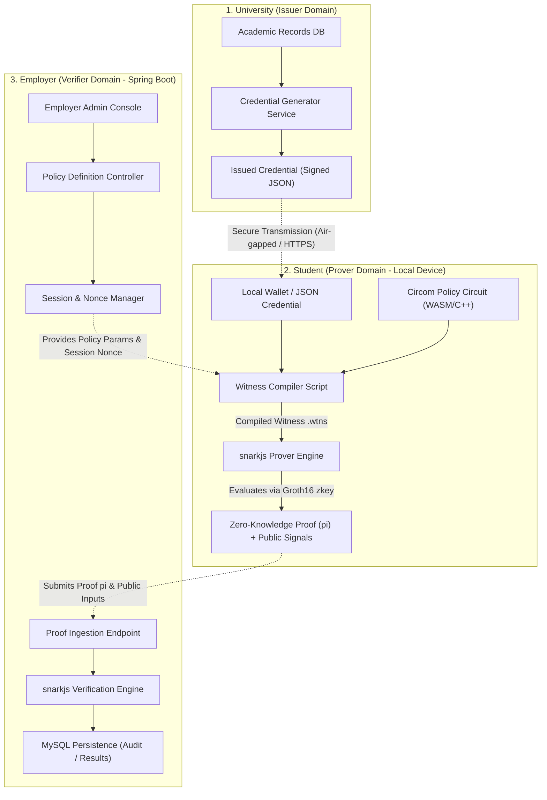
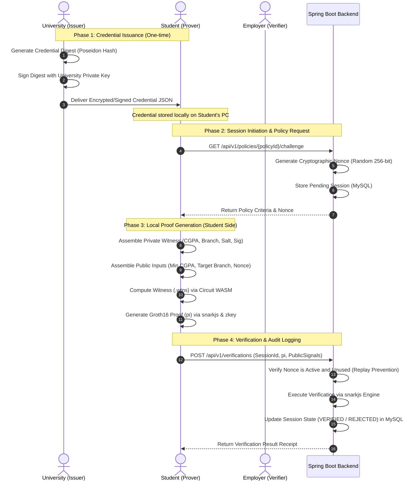
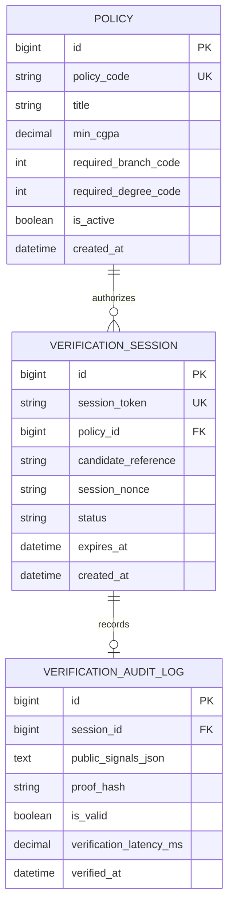

# Policy-Driven Zero-Knowledge Verification for Privacy-Preserving Academic Credentials

[](https://adoptium.net/)
[](https://spring.io/projects/spring-boot)
[](https://github.com/iden3/circom)
[](https://github.com/iden3/snarkjs)
[](https://eprint.iacr.org/2016/260)
[](#24-development-roadmap-with-task-checklists)

---

## 1. Project Overview

**Policy-Driven Zero-Knowledge Verification for Privacy-Preserving Academic Credentials** is a final-year academic research and engineering project designed to address the fundamental privacy and over-disclosure flaws in modern credential verification systems. 

In traditional verification workflows, when an employer, scholarship board, or institutional verifier needs to confirm whether an applicant meets specific eligibility criteria—such as having a minimum Cumulative Grade Point Average (CGPA) or holding a specific degree—the applicant is forced to submit full, unredacted academic transcripts. This legacy approach violates the principle of **data minimization**: it unnecessarily exposes sensitive personal identifiers (Student ID, Date of Birth, National ID), full course histories, semester-by-semester failures, and precise grade distributions to third parties who only require a binary boolean answer: *"Does the applicant satisfy policy $\mathcal{P}$?"*

This project introduces a privacy-preserving verification framework combining **Zero-Knowledge Succinct Non-Interactive Arguments of Knowledge (zk-SNARKs)** with an enterprise-grade **Spring Boot backend** and **MySQL metadata management**. Using arithmetic circuits parameterized by employer-defined policies and executed entirely on the student's local device, an applicant generates a zero-knowledge proof ($\pi$) demonstrating that their genuine academic credential satisfies all required policy predicates without disclosing:
1. Their actual numerical CGPA.
2. Their institutional identification details or private transcripts.
3. Intermediate cryptographic witness values.

The verifier receives only the succinct cryptographic proof along with public policy and session parameters, mathematically validating eligibility in constant time ($O(1)$ pairing checks) while ensuring private attributes never leave the student's perimeter.

---

## 2. Problem Statement

Modern academic verification suffers from three systemic vulnerabilities:

1. **Systemic Over-Disclosure (Transitive Privacy Leakage):** Academic transcripts are monolithic documents. Verifying a simple threshold claim (e.g., $\text{CGPA} \ge 7.5$) leaks an applicant's complete educational history, detailed grades across unrelated disciplines, academic probations, and demographic metadata.
2. **Centralized Phone-Home Verification:** Traditional digital verification platforms often require verifiers to query university portal APIs directly during an application. This creates a tracking channel where the issuing university learns where, when, and how frequently a graduate is applying for employment or opportunities.
3. **Vulnerability to Forgery vs. Privacy Trade-Off:** Organizations attempting to solve over-disclosure through manual redaction introduce severe forgery risks, while cryptographic digital signatures over plain text transcripts fail to provide selective disclosure or threshold proving capabilities out of the box.

**Formal Problem Statement:**  
*How can an academic credential holder prove to a semi-honest third-party verifier that their university-issued academic attributes satisfy an arbitrary conjunction of comparison and equality predicates defined by an eligibility policy $\mathcal{P}$, such that the verifier gains mathematical certainty of compliance and credential authenticity, while learning zero knowledge regarding the holder's underlying attributes beyond the validity of the statement?*

---

## 3. Motivation and Objectives

### Motivation
With the global rise of regulatory privacy mandates (e.g., GDPR Article 5(1)(c) on Data Minimization, India's DPDP Act 2023), software architectures handling personal data must enforce privacy by design. In recruitment, academic qualifications determine candidate eligibility, yet employers do not have a legitimate business need to store historical course-by-course failures or exact GPAs for disqualified or shortlisted candidates. Implementing zero-knowledge verification eliminates liability for employers holding excess personal data while providing tamper-proof fraud resistance.

### Primary Objectives
- **Zero-Knowledge Policy Evaluation:** Design and implement modular arithmetic circuits in Circom that evaluate range checks ($\text{CGPA} \ge \text{threshold}$) and categorical equality claims ($\text{Branch} = \text{Target}$, $\text{Degree} = \text{Target}$) over finite fields.
- **Strict Client-Side Witness Generation:** Ensure that all private academic data and witness compilation tools execute strictly on the student (prover) device.
- **Cryptographic Policy and Session Binding:** Implement cryptographic binding mechanisms (via Poseidon hashing and verifier-issued challenge nonces) to prevent replay attacks, proof front-running, and unauthorized proof reuse across different verifiers.
- **Backend Policy Orchestration:** Construct a Spring Boot service to manage policy lifecycle definitions, issue challenge sessions, and execute cryptographic proof verification.
- **Empirical Performance Profiling:** Benchmarking constraint counts, prover generation latency, proof size, memory utilization, and verification throughput across varying policy complexities.

---

## 4. Proposed Solution

The proposed architecture adopts a decoupled, three-party verification model using **Groth16 zk-SNARKs** over the **BN254 (alt_bn128)** elliptic curve:

```
+--------------------------------------------------------------------------------------------------+
|                                    PROPOSED SYSTEM OVERVIEW                                      |
+--------------------------------------------------------------------------------------------------+
                                                                                                    
   +--------------------+          1. Issues Signed Credential          +--------------------+      
   |     UNIVERSITY     | --------------------------------------------> |      STUDENT       |      
   |     (Issuer)       |           (Offline / Tamper-Proof)            |  (Holder / Prover) |      
   +--------------------+                                               +--------------------+      
                                                                                   |                
                                                                                   | 3. Computes    
                                                                                   |    Private     
                                      2. Fetch Policy & Session Nonce              |    Witness     
                                 <---------------------------------------+         |    & Generates 
                                 |                                       |         |    Proof (pi)  
                                 v                                       |         v    Locally     
                        +--------------------+                           |   [ Circom Circuit ]     
                        |      EMPLOYER      |                           |   [ snarkjs Prover ]     
                        |     (Verifier)     |                           |         |                
                        +--------------------+                           |         |                
                                 ^                                       |         |                
                                 |          4. Submits Proof pi          |         |                
                                 |             & Public Inputs           |         |                
                                 +---------------------------------------+---------+                
                                 |                                                                  
                                 v                                                                  
                    [ Spring Boot Backend ]                                                         
                    [ Verification Engine ] ---> Validates pi via Pairing in O(1) Time              
                    [ MySQL Storage ]       ---> Logs Audit State & Invalidates Nonce               
```

- **Credential Representation:** Credentials are structured JSON records signed by the University, with individual attributes and blinding salts bound through an algebraic commitment.
- **Client-Side Prover (Student):** The student downloads the compiled R1CS/WASM artifacts and proves credential satisfaction on their personal workstation using a dedicated CLI wrapper around `snarkjs`.
- **Verifier Service (Employer):** A Spring Boot REST application allows employers to publish eligibility policies, generate cryptographic session nonces, and verify received proofs via automated verification scripts.

---

## 5. Research Positioning and Research Gap

### Research Positioning
This research is situated at the intersection of **Applied Cryptography (Zero-Knowledge Proofs)** and **Enterprise Privacy Engineering**. It leverages established SNARK constructions (Groth16) and algebraic hash primitives (Poseidon) to construct an end-to-end, domain-specific credential verification pipeline without requiring complex blockchain networks or global public ledgers.

### Identified Research Gaps
While academic literature extensively covers decentralized identity (DID) and generalized zk-SNARK constructions, practical gaps persist in lightweight, enterprise-aligned architectures:

| Existing Paradigm | Typical Characteristics | Practical Research Gap Addressed in This Project |
| :--- | :--- | :--- |
| **Traditional PKI & Digital Transcripts** | Transcripts signed with X.509 certificates (e.g., Adobe PDF signatures). | **Zero Selective Disclosure:** Requires disclosing the complete document to verify a single signature; no arithmetic or range predicate support. |
| **Blockchain-Based Credential Systems** | Anchors credential hashes or identity DIDs on Ethereum, Hyperledger, or Polygon. | **Unnecessary Overhead & Cost:** High gas fees, latency, public ledger correlation risks, regulatory compliance issues (GDPR "Right to be Forgotten" conflicts with immutable ledgers). |
| **Anonymous Credentials (BBS+ / CL Signatures)** | Camenisch-Lysyanskaya (CL) or BBS+ signatures supporting selective disclosure. | **Limited Arithmetic Predicates:** Highly effective for equality and attribute disclosure, but complex arithmetic inequalities ($\text{CGPA} \ge 7.5$) require complex zero-knowledge range protocols that are non-trivial to parameterize dynamically compared to general-purpose R1CS circuits. |
| **Generalized zk-SNARK Frameworks** | Theoretical Circom circuits for toy puzzles (e.g., Sudoku, Tornado-style mixers). | **Lack of Enterprise Integration:** Rarely integrated with enterprise application layers (e.g., Spring Boot, relational databases, dynamic session orchestration, and policy management). |

**Our Focus:** A lightweight, non-blockchain, enterprise-integrated architecture providing dynamic policy-parameterized verification with strict session binding to prevent relay attacks.

---

## 6. Related Research Papers and Standards

This work builds upon foundational advances in non-interactive zero-knowledge arguments, algebraic hashing, and verifiable credentials:

1. **Groth, J. (2016).** *"On the Size of Pairing-Based Non-interactive Arguments."* In *EUROCRYPT 2016*, Lecture Notes in Computer Science, vol 9666, pp. 305–326. Springer. [DOI: 10.1007/978-3-662-49896-5_11](https://doi.org/10.1007/978-3-662-49896-5_11).
   - *Relevance:* Defines the Groth16 zk-SNARK construction, yielding constant proof sizes of 3 group elements (2 in $G_1$, 1 in $G_2$) and constant-time pairing verification ($O(1)$).
2. **Grassi, L., Khovratovich, D., Rechberger, C., Schofnegger, M., & Subasic, R. (2021).** *"Poseidon: A New Hash Function for Zero-Knowledge Proof Systems."* In *USENIX Security Symposium 2021*, pp. 519–535. [USENIX](https://www.usenix.org/conference/usenixsecurity21/presentation/grassi).
   - *Relevance:* Provides the Hades permutation-based algebraic hash function over the scalar field $\mathbb{F}_r$ of BN254, dramatically reducing R1CS constraint consumption compared to SHA-256.
3. **Camenisch, J., & Lysyanskaya, A. (2001).** *"An Efficient System for Non-transferable Anonymous Credentials with Optional Anonymity Revocation."* In *EUROCRYPT 2001*, pp. 93–118. [DOI: 10.1007/3-540-44987-6_7](https://doi.org/10.1007/3-540-44987-6_7).
   - *Relevance:* Foundational privacy architecture establishing proof of attribute possession without identity revelation.
4. **Bowe, S., Gabizon, A., & Green, M. (2018).** *"A Multi-party Protocol for Constructing zk-SNARK Parameters (Powers of Tau)."* Cryptology ePrint Archive, Report 2017/1050. [ePrint](https://eprint.iacr.org/2017/1050).
   - *Relevance:* Establishes the universal structured reference string (SRS) ceremony methodology adopted for BN254 circuit setups in `snarkjs`.
5. **W3C Verifiable Credentials Data Model v2.0.** W3C Proposed Recommendation (2024). [W3C VC Spec](https://www.w3.org/TR/vc-data-model-2.0/).
   - *Relevance:* Conceptual alignment for claims, issuers, holders, and verifiers.

---

## 7. High-Level System Architecture

The architecture is partitioned into three distinct trust zones: **Issuer Domain**, **Prover (Student) Domain**, and **Verifier (Employer) Domain**.



---

## 8. Three-Party Architecture



---

## 9. Detailed Component Responsibilities

### 1. University (Credential Issuer)
- **Attribute Authority:** Maintains canonical academic transcripts.
- **Canonical Serialization:** Formats student records into deterministic attribute vectors over $\mathbb{F}_r$.
- **Digital Attestation:** Signs the credential root commitment using the university's private signing key.
- **Out-of-Band Delivery:** Distributes the signed credential payload directly to the student without retaining verifier-specific tracking logs.

### 2. Student (Holder & Prover)
- **Local Storage:** Stores raw credentials, blinding salts, and private keys locally in `prover/credentials/`.
- **Policy Ingestion:** Fetches public eligibility criteria ($\text{minCGPA}$, $\text{reqBranch}$, etc.) and temporary session nonces from the employer.
- **Zero-Knowledge Witness Compilation:** Feeds private credentials and public parameters into the circuit witness generator.
- **Proof Generation:** Executes `snarkjs` locally against `circuit_final.zkey` to produce proof $\pi = (A, B, C)$.
- **Proof Dispatch:** Transmits solely the proof and public inputs to the employer.

### 3. Employer (Policy Verifier)
- **Policy Authoring:** Configures specific eligibility thresholds (e.g., $\text{minCGPA} \ge 7.5$, $\text{Branch} = \text{CSE}$) via Spring Boot REST APIs.
- **Replay Protection:** Generates cryptographically secure, time-bounded session nonces stored in MySQL.
- **Cryptographic Verification:** Validates proof $\pi$ against `verification_key.json` and asserts public input matching.
- **Audit Logging:** Records timestamped verification receipts without ever persisting or viewing raw student grades.

---

## 10. Complete End-to-End Verification Workflow

```
[ UNIVERSITY ]
      |
      | 1. Generates Credential JSON:
      |    - Attributes: { cgpa: 8.42, branch: 101, degree: 1, salt: 0x3f... }
      |    - Commitment: C = Poseidon(cgpa, branch, degree, salt)
      |    - Signature:  Sig_Univ(C)
      v
[ STUDENT LOCAL WORKSTATION ]
      |
      | 2. Requests active verification session from Employer:
      |    <- Returns: { policyId: "POL-2026-CSE", minCgpa: 7.50, reqBranch: 101, nonce: 0x9b4... }
      |
      | 3. Prepares Circuit Inputs:
      |    Private Witness: { actual_cgpa, actual_branch, actual_degree, salt, univ_sig }
      |    Public Signals:  { min_cgpa, expected_branch, expected_degree, session_nonce, univ_pk }
      |
      | 4. Compiles Witness & Generates zk-SNARK Proof:
      |    $ node generate_witness.js circuit.wasm input.json witness.wtns
      |    $ snarkjs groth16 prove circuit_final.zkey witness.wtns proof.json public.json
      |
      | 5. Submits Payload: { proof.json, public.json, sessionId }
      v
[ EMPLOYER SPRING BOOT BACKEND ]
      |
      | 6. Validates Session:
      |    - Checks session exists, is PENDING, and within expiration window.
      |    - Asserts public.json matches expected session_nonce & policy parameters.
      |
      | 7. Executes Verification:
      |    $ snarkjs groth16 verify verification_key.json public.json proof.json
      |
      | 8. Database Update:
      |    - Flags session as COMPLETED (nonce consumed).
      |    - Stores verification outcome: SUCCESS / FAILED.
```

---

## 11. Cryptographic Architecture

### Elliptic Curve Setting: BN254 (alt_bn128)
The system operates over the pairing-friendly curve $E(\mathbb{F}_q)$ defined by $y^2 = x^3 + 3$, equipped with an optimal Ate pairing:
$$e: G_1 \times G_2 \to G_T$$
where:
- $\mathbb{F}_q$ is the base field of prime order:
  $$q = 21888242871839275222246405745257275088696311157297823662689037894645226208583$$
- $\mathbb{F}_r$ is the scalar field (circuit constraint field) of prime order:
  $$r = 21888242871839275222246405745257275088548364400416034343698204186575808495617$$

### Groth16 zk-SNARK Scheme
The circuit relations are compiled into a Quadratic Arithmetic Program (QAP):
$$L(x) \cdot R(x) - O(x) = H(x) \cdot T(x)$$
A valid proof consists of three group elements:
$$\pi = (A \in G_1, \; B \in G_2, \; C \in G_1)$$
The verification equation evaluates whether:
$$e(A, B) = e(\alpha, \beta) \cdot e\left(\sum_{i=0}^{\ell} x_i \cdot \gamma_i, \; \delta\right) \cdot e(C, \delta)$$
where $x_0, \dots, x_\ell \in \mathbb{F}_r$ are the public inputs, and $(\alpha, \beta, \gamma, \delta)$ are structured reference string (SRS) elements from the trusted setup.

### Poseidon Algebraic Hash Function
For in-circuit hashing and commitments, standard bit-oriented functions (SHA-256) are computationally prohibitive ($\approx 25,000$ R1CS constraints per block). Instead, this project uses **Poseidon** over $\mathbb{F}_r$, which utilizes $S$-boxes of degree $x^5$ (since $\gcd(5, r-1) = 1$):
- Full rounds ($R_F = 8$) and partial rounds ($R_P = 57$).
- Reduces hash constraint cost to $\approx 240 - 350$ constraints per hash evaluation.

---

## 12. Public Inputs and Private Witnesses

To ensure strict zero-knowledge privacy, circuit variables are explicitly partitioned:

| Variable Name | Classification | Domain | Cryptographic Purpose |
| :--- | :--- | :--- | :--- |
| `actual_cgpa` | **Private Witness** | $\mathbb{F}_r$ (Scaled: $8.42 \to 842$) | Student's true GPA. Kept strictly private on client. |
| `actual_branch` | **Private Witness** | $\mathbb{F}_r$ (Numeric Enum: `CSE` $\to 101$) | Actual academic branch of study. Kept private. |
| `actual_degree` | **Private Witness** | $\mathbb{F}_r$ (Numeric Enum: `BE` $\to 1$) | Actual degree conferred. Kept private. |
| `credential_salt` | **Private Witness** | $\mathbb{F}_r$ (256-bit random scalar) | High-entropy blinding factor preventing brute-force dictionary attacks. |
| `issuer_sig_r` | **Private Witness** | $\mathbb{F}_r$ (Curve point scalar) | University signature $R$ component. |
| `issuer_sig_s` | **Private Witness** | $\mathbb{F}_r$ (Curve point scalar) | University signature $S$ component. |
| `min_cgpa` | **Public Input** | $\mathbb{F}_r$ (Scaled: $7.50 \to 750$) | Employer-specified minimum GPA threshold. |
| `expected_branch` | **Public Input** | $\mathbb{F}_r$ (Numeric Enum: `101`) | Employer-specified target branch. |
| `expected_degree` | **Public Input** | $\mathbb{F}_r$ (Numeric Enum: `1`) | Employer-specified target degree. |
| `session_nonce` | **Public Input** | $\mathbb{F}_r$ (256-bit fresh nonce) | Cryptographic challenge issued by Employer for replay prevention. |
| `issuer_pubkey_x` | **Public Input** | $\mathbb{F}_r$ (Curve coordinate) | Public key of the issuing institution. |
| `issuer_pubkey_y` | **Public Input** | $\mathbb{F}_r$ (Curve coordinate) | Public key of the issuing institution. |

---

## 13. Policy Circuit and Mathematical Representation

### Integer Scaling for Floating-Point Numbers
Finite fields $\mathbb{F}_r$ natively support modular integer arithmetic, not IEEE-754 floating-point numbers. To verify decimal GPAs without precision loss, all values are fixed-point scaled by factor $10^2$ (or $10^4$):
$$\text{scaled\_cgpa} = \lfloor \text{actual\_cgpa} \times 100 \rfloor$$
$$\text{scaled\_min\_cgpa} = \lfloor \text{min\_cgpa} \times 100 \rfloor$$

### Arithmetic Constraints in R1CS

#### 1. Range Inequality ($\text{CGPA} \ge \text{minCGPA}$)
To verify $A \ge B$ without revealing $A$, the circuit computes the difference $\Delta = A - B$ and proves that $\Delta \in [0, 2^k - 1]$ through $k$-bit binary decomposition:
$$\Delta = \sum_{i=0}^{k-1} b_i \cdot 2^i \quad \text{where } b_i \cdot (1 - b_i) = 0, \; \forall i \in \{0, \dots, k-1\}$$
For GPAs scaled up to $1000$ (representing 10.00), $k = 12$ bits ($2^{12} = 4096$) is sufficient to avoid modular field wrap-around.

#### 2. Categorical Equality Constraints
Branch and degree compliance are enforced via linear constraint equality:
$$(\text{actual\_branch} - \text{expected\_branch}) = 0$$
$$(\text{actual\_degree} - \text{expected\_degree}) = 0$$

#### 3. Cryptographic Policy & Nonce Binding
To ensure the proof cannot be replayed or detached from its policy session, the public inputs are bound within the constraint system:
$$\text{PolicyHash} = \text{Poseidon}(\text{scaled\_min\_cgpa}, \text{expected\_branch}, \text{expected\_degree})$$
$$\text{SessionBinding} = \text{Poseidon}(\text{PolicyHash}, \text{session\_nonce})$$

---

## 14. Credential Authenticity and Issuer-Signature Integration

A proof of eligibility is meaningless if the prover can construct a valid proof over self-fabricated credential inputs. The circuit must verify that the private attributes were genuinely attested by the University.

```
                      +------------------------------------------+
                      |         STUDENT PRIVATE CREDENTIAL       |
                      |  cgpa, branch, degree, credential_salt   |
                      +------------------------------------------+
                                           |
                                           v
                             [ Poseidon Hash Primitive ]
                                           |
                                           v
                             Root Commitment Hash (C)
                                           |
                      +--------------------+---------------------+
                      |                                          |
                      v                                          v
      [ University Signed Digest ]               [ In-Circuit Signature Check ]
      Sig_Univ = Sign(SK_Univ, C)                 Assert: VerifySig(PK_Univ, C, Sig) == 1
```

1. **Commitment Construction:** The University computes a root digest over all attributes:
   $$C = \text{Poseidon}(\text{scaled\_cgpa}, \text{branch}, \text{degree}, \text{salt})$$
2. **University Signature:** The University signs $C$ using an algebraic signature scheme (e.g., EdDSA over the BabyJubjub curve, natively supported in Circom).
3. **In-Circuit Verification:** The circuit takes $(C, \text{Sig}, \text{PK}_{\text{Univ}})$ as private inputs and re-computes:
   - $C' \stackrel{?}{=} \text{Poseidon}(\text{actual\_cgpa}, \text{actual\_branch}, \text{actual\_degree}, \text{salt})$
   - $\text{EdDSAVerify}(\text{PK}_{\text{Univ}}, C', \text{Sig}) \stackrel{?}{=} 1$
   - Only $\text{PK}_{\text{Univ}}$ is exposed as a public input.

---

## 15. Security and Privacy Requirements

- **Completeness:** If the student holds a genuine credential signed by the University and their attributes satisfy the policy, an honest prover will always generate a proof $\pi$ that passes verification with probability 1.
- **Computational Soundness:** A computationally bounded adversary holding invalid or non-compliant credentials cannot forge a proof $\pi^*$ that satisfies the verification equation, except with negligible probability $\epsilon \le \mathcal{O}(d/r)$.
- **Zero-Knowledge (Privacy):** The proof $\pi$ reveals no information about private attributes $(\text{actual\_cgpa}, \text{branch}, \text{degree}, \text{salt})$ beyond the validity of the statement. There exists a polynomial-time simulator that can generate indistinguishable proofs without access to the witness, given the trapdoors.
- **Replay Resistance:** Proofs are cryptographically tied to a single-use session nonce ($N_s$). Verifying the same proof under a different session nonce fails.
- **Non-Transferability:** An applicant cannot front-run or steal another student's proof because verification sessions require binding to the applicant's designated session ID.

---

## 16. Threat Model

| Threat Vector | Adversary Objective | System Countermeasure |
| :--- | :--- | :--- |
| **Grade Tampering** | Prover with CGPA = 6.8 attempts to prove CGPA $\ge 7.5$. | **Soundness of R1CS:** Constraint system prevents valid witness generation; cannot satisfy 12-bit decomposition without violating field constraints. |
| **Credential Forgery** | Prover fabricates arbitrary credentials out of thin air. | **Issuer Signature Constraint:** Circuit checks that the attribute commitment matches an authentic signature from the University's public key. |
| **Proof Replay Attack** | Prover intercepts a peer's valid proof $\pi$ and submits it to another employer. | **Session Nonce Binding:** Each proof incorporates a fresh, single-use `session_nonce` as a public signal. The employer rejects any nonce not actively registered. |
| **Brute-Force Attribute Inversion** | Verifier attempts to invert small-domain attributes (e.g., testing all degrees 1..10). | **Cryptographic Salting:** Every credential incorporates a high-entropy 256-bit blinding factor (`credential_salt`), rendering brute-force pre-image attacks infeasible. |
| **Man-in-the-Middle (MitM) Tampering** | Adversary alters public policy parameters in transit. | **Pairing Equation Evaluation:** Any tampering with public signals invalidates the pairing identity $e(A, B) = e(\alpha, \beta) \cdot \dots$ |

---

## 17. Database Design

The Spring Boot backend utilizes **MySQL 8.0** to persist policy templates, active verification sessions, and auditable proof outcomes.



---

## 18. Technology Stack

| Layer / Role | Technology | Version | Purpose |
| :--- | :--- | :--- | :--- |
| **Prover Circuits** | Circom | `2.2.3` | Compiles arithmetic constraint circuits to R1CS and C++/WASM witness generators. |
| **ZKP Framework** | snarkjs | `0.7.6` | Trusted setup execution (Powers of Tau), witness generation, Groth16 proving and verification. |
| **Curve & Cryptography** | BN254 / Poseidon | Standard | Pairing-friendly elliptic curve and algebraic hashing over $\mathbb{F}_r$. |
| **Backend Framework** | Java / Spring Boot | `21 LTS` / `3.x` | Orchestrates policies, session nonces, verification endpoints, and audit records. |
| **Database Engine** | MySQL Server | `8.0.34` | Stores verification sessions, policy parameters, and benchmark audit logs. |
| **Build & Tooling** | Maven Wrapper | `3.9.9` / `3.9.16` | Deterministic, headless compilation of backend services. |
| **Runtime Environment** | Node.js / npm | `v22.7.0` / `10.8.2` | Executes client-side proof generation scripts and snarkjs CLI. |

---

## 19. Research Methodology

```
+--------------------------------------------------------------------------------------------------+
|                                    RESEARCH METHODOLOGY PHASES                                   |
+--------------------------------------------------------------------------------------------------+
                                                                                                    
  [ Phase 1: Cryptographic Modeling ]                                                               
  - Define R1CS arithmetic predicates for threshold checks and categorical equality.               
  - Select fixed-point scaling factor and bit-width limits (12-bit decomposition).                  
  - Formulate Poseidon-based credential commitments and session nonce binding.                     
                                   |                                                                
                                   v                                                                
  [ Phase 2: Circuit Implementation & Ceremony ]                                                    
  - Author Circom circuits: policy_verifier.circom, comparators.circom, hash_commitment.circom.     
  - Execute Phase 1 Powers of Tau ceremony and Phase 2 circuit-specific Groth16 setup.              
  - Export verification_key.json and compiled WASM witness generator.                               
                                   |                                                                
                                   v                                                                
  [ Phase 3: Prover CLI & Backend Development ]                                                     
  - Construct student-side CLI prover scripts in Node.js/snarkjs.                                   
  - Implement Spring Boot REST services for policy management and verification session orchestration.
  - Configure MySQL schema migrations and persistence layer.                                       
                                   |                                                                
                                   v                                                                
  [ Phase 4: Empirical Evaluation & Benchmarking ]                                                  
  - Profile circuit constraint counts across 1, 2, 4, and 8 policy predicates.                     
  - Measure prover memory usage, proof generation latency, and backend verification time.           
  - Perform security penetration tests (replay attacks, invalid inputs, signature bypass attempts). 
```

---

## 20. Experimental Evaluation Metrics

The experimental phase will profile performance across standardized dimensions:

1. **Circuit Complexity:** Total R1CS linear constraints ($|C|$), private variables, public variables, and labels.
2. **Prover Resource Consumption:**
   - Client witness generation latency ($T_{\text{witness}}$ in ms).
   - Groth16 proof generation latency ($T_{\text{prove}}$ in ms).
   - Peak resident memory (RAM) on consumer-grade student devices.
3. **Proof Artifact Size:** Transmission payload in bytes (JSON representation of points $A, B, C$).
4. **Verifier Throughput:**
   - Verification execution latency ($T_{\text{verify}}$ in ms).
   - Verification throughput (proofs validated per second per backend thread).
5. **Scaling Profile:** Comparative metrics as policy conditions grow from a single predicate ($\text{CGPA} \ge 7.5$) to complex multi-attribute policies (CGPA, Branch, Degree, Graduation Year, University Accreditation).

---

## 21. Computational Complexity Analysis

| Operation | Entity | Asymptotic Complexity | Typical Empirical Magnitude | Notes |
| :--- | :--- | :--- | :--- | :--- |
| **Witness Generation** | Prover (Student) | $\mathcal{O}(|C|)$ | $\sim 50 - 150 \text{ ms}$ | Linear in the number of arithmetic constraints. |
| **Proof Generation (Groth16)** | Prover (Student) | $\mathcal{O}(|C| \log |C|)$ | $\sim 800 - 2500 \text{ ms}$ | Dominated by multi-scalar multiplication (MSM) in $G_1, G_2$ and FFT/NTT. |
| **Prover Memory** | Prover (Student) | $\mathcal{O}(|C|)$ | $\sim 80 - 250 \text{ MB}$ | Storing constraint polynomials and evaluation domains. |
| **Proof Size** | Channel | $\mathcal{O}(1)$ | **128 bytes** (Compressed) | Constant: $2 \times G_1$ elements + $1 \times G_2$ element. |
| **Verification Time** | Verifier (Employer) | $\mathcal{O}(1)$ pairings $+ \; \mathcal{O}(\ell)$ MSM | $\sim 2 - 5 \text{ ms}$ | 3 bilinear pairing operations; $\ell$ is number of public signals ($\ell \approx 5$). |

---

## 22. Expected Research Contributions

1. **Lightweight, Non-Blockchain Architecture:** Demonstrates an enterprise-ready Zero-Knowledge credential verification framework that eliminates blockchain reliance, gas costs, and public ledger privacy leakage.
2. **Dynamic Policy Parameterization:** A reusable circuit architecture that validates dynamic policy criteria without requiring a new trusted setup ceremony for every distinct employer threshold.
3. **Cryptographic Replay Resistance:** A practical nonce-binding protocol connecting public verification sessions to SNARK inputs, preventing proof interception and unauthorized re-use.
4. **Empirical Benchmarks:** Comprehensive performance and constraint profiling on consumer hardware, proving the viability of client-side ZKP generation for higher education applications.

---

## 23. Testing Strategy

```
+--------------------------------------------------------------------------------------------------+
|                                    FOUR-TIER TESTING STRATEGY                                    |
+--------------------------------------------------------------------------------------------------+

  [ Tier 1: Circuit Constraint Tests (Mocha / Chai / Circom Tester) ]
  * Positive test: Prover with CGPA = 8.0 satisfies threshold 7.5.
  * Negative test: Prover with CGPA = 7.4 fails constraint satisfaction.
  * Boundary test: Prover with CGPA = 7.5 exactly satisfies threshold.
  * Bit-overflow test: Prover difference exceeding 12-bit decomposition triggers constraint failure.

  [ Tier 2: Cryptographic Security Tests (Negative Test Suite) ]
  * Replay Attack: Re-submitting proof pi with a stale nonce N_s must fail.
  * Front-Running: Modifying public inputs while retaining proof pi must fail pairing check.
  * Forgery Test: Proof generated with random salt and invalid signature fails verification.

  [ Tier 3: Backend API Integration Tests (Spring Boot Test / JUnit 5 / Testcontainers) ]
  * Policy lifecycle management (CRUD).
  * Session generation and expiration enforcement.
  * snarkjs wrapper execution and response parsing.

  [ Tier 4: End-to-End System Tests ]
  * Full pipeline execution: Credential Creation -> Prover CLI -> REST API -> MySQL Update.
```

---

## 24. Development Roadmap with Task Checklists

### Milestone 1: Repository Foundation & Toolchain Audit *(Completed)*
- [x] Establish structured workspace directories (`backend/`, `circuits/`, `prover/`, `docs/`, `experiments/`).
- [x] Configure comprehensive `.gitignore` for Java, Node.js, and ZKP artifacts.
- [x] Conduct deep environment audit of local development tools.
- [x] Download, verify SHA-256 (`a4dbaa...`), and extract Eclipse Temurin JDK 21 LTS (`jdk-21.0.13+9`).
- [x] Configure user-level `JAVA_HOME` and verify Maven 3.9.9 execution on JDK 21.

### Milestone 2: Circuit Design & Trusted Setup Ceremony *(Next Milestone)*
- [ ] Implement `comparators.circom` and integer fixed-point range checks.
- [ ] Implement `policy_verifier.circom` combining GPA comparisons and branch/degree checks.
- [ ] Integrate Poseidon hash commitments for attribute binding.
- [ ] Execute Powers of Tau ceremony (bn128) and generate circuit-specific proving key (`circuit_final.zkey`).
- [ ] Export `verification_key.json` and generate circuit WASM artifacts.

### Milestone 3: Student Prover CLI Tooling
- [ ] Implement credential generation utility mimicking university attestation.
- [ ] Develop student-side CLI runner in `prover/` to parse local JSON credentials.
- [ ] Implement automated witness calculation and proof generation script.
- [ ] Package student payload generator producing standardized `{ proof, public_signals }` payloads.

### Milestone 4: Spring Boot Backend & Database Integration
- [ ] Initialize Spring Boot 3.x backend application with Maven Wrapper.
- [ ] Define MySQL entities for policies, verification sessions, and audit receipts.
- [ ] Implement REST endpoints:
  - `POST /api/v1/policies` — Author eligibility policy.
  - `POST /api/v1/sessions` — Issue fresh challenge nonce.
  - `POST /api/v1/verify` — Accept and verify submitted proof payload.
- [ ] Implement verification service wrapping `snarkjs` / pairing engine.

### Milestone 5: Empirical Benchmarking & Research Publication
- [ ] Build automated benchmarking harness in `experiments/`.
- [ ] Record prover execution time, memory usage, and constraint counts across varying policy sizes.
- [ ] Author formal research project report and documentation.

---

## 25. Project Scope and Limitations

### In Scope
- Verification of numerical thresholds (CGPA, marks) and categorical values (Branch, Degree, Year).
- Single-institution credential attestation via cryptographic commitments and signatures.
- Local, client-side proof generation on standard developer and student personal computers.
- Single-use session nonce protocol preventing proof replay.
- Spring Boot enterprise backend service with MySQL persistence.

### Out of Scope & Limitations
- **No Blockchain / Distributed Ledger:** The project deliberately avoids smart contracts, token incentives, and blockchain state to ensure privacy, performance, and legal compliance (GDPR).
- **Trusted Setup Dependency:** Groth16 requires a circuit-specific structured reference string (SRS) generated via a multi-party computation (MPC) ceremony. A compromised setup compromise soundness.
- **Single Credential per Proof:** Current circuit scope verifies credentials issued under a single university schema; cross-institutional multi-credential joins are reserved for future iterations.

---

## 26. Expected Final Outcome

Upon completion, the project will deliver:
1. **A Fully Verifiable Zero-Knowledge Circuit Suite:** Production-ready Circom circuits compiling to under 1,500 R1CS constraints, ensuring proof generation times under 2 seconds on consumer laptops.
2. **Student Prover Suite:** A standalone, privacy-preserving command-line tool allowing students to prove eligibility locally from an encrypted or JSON credential file.
3. **Employer Verification Platform:** A high-performance Spring Boot service capable of issuing challenge sessions and validating academic proofs in under 5 milliseconds.
4. **Empirical Research Dataset:** Comprehensive benchmark logs and graphs comparing proof generation overhead, memory constraints, and verification latencies.

---

## 27. Future Research Directions

- **Universal SNARK Migration (PLONK / Halo2):** Eliminating circuit-specific trusted setups by migrating from Groth16 to universal SRS schemes (PLONK) or transparent setups (Halo2 / IPA).
- **Post-Quantum ZKP Integration:** Investigating STARKs (Scalable Transparent Arguments of Knowledge) based solely on collision-resistant hash functions to provide post-quantum security against Shor's algorithm.
- **Revocation Accumulators:** Integrating cryptographic cryptographic accumulators (e.g., Merkle trees or bilinear accumulators) to support instant credential revocation without centralized verifier queries.
- **Multi-Credential Cross-Verification:** Expanding circuits to enable simultaneous proofs across multiple academic degrees or professional certifications.

---

## 28. Repository Structure

```
Academic-ZKP-Verification/
├── backend/                            # Spring Boot verification & policy service (Milestone 4)
│   ├── src/main/java/                  # Backend controllers, services, repositories
│   ├── src/main/resources/             # application.yml, database schema migrations
│   └── pom.xml                         # Maven build configuration
│
├── circuits/                           # Circom zero-knowledge circuit definitions (Milestone 2)
│   ├── templates/                      # Modular circuit templates (comparators, hashers)
│   ├── policy_verifier.circom          # Main academic policy verification circuit
│   ├── build/                          # Compiled R1CS, sym, and WASM generators
│   └── setup/                          # Powers of Tau, zkey files, verification_key.json
│
├── prover/                             # Student-side proof generation tooling (Milestone 3)
│   ├── credentials/                    # Mock local credentials (gitignored private data)
│   ├── generate_proof.js               # CLI script compiling witness and executing snarkjs
│   └── package.json                    # Local npm dependencies (snarkjs)
│
├── docs/                               # Research documentation & architecture decisions
│   ├── design-decisions/               # Architectural Decision Records (ADRs)
│   └── research-notes/                 # Literature surveys, cryptographic math derivations
│
├── experiments/                        # Benchmarking & performance evaluation (Milestone 5)
│   ├── benchmarks/                     # Execution time & memory profiling scripts
│   └── results/                        # CSV logs, constraint tables, and latency plots
│
├── .gitignore                          # Excludes build outputs, keys, and private credentials
└── README.md                           # Comprehensive project research documentation
```

---

## 29. Research References

1. **Groth, J.** (2016). *On the Size of Pairing-Based Non-interactive Arguments.* In: International Conference on the Theory and Applications of Cryptographic Techniques (EUROCRYPT 2016), Lecture Notes in Computer Science, vol 9666, pp. 305–326. Springer, Berlin, Heidelberg. [https://doi.org/10.1007/978-3-662-49896-5_11](https://doi.org/10.1007/978-3-662-49896-5_11).
2. **Grassi, L., Khovratovich, D., Rechberger, C., Schofnegger, M., & Subasic, R.** (2021). *Poseidon: A New Hash Function for Zero-Knowledge Proof Systems.* In: 30th USENIX Security Symposium (USENIX Security 21), pp. 519–535. [https://www.usenix.org/conference/usenixsecurity21/presentation/grassi](https://www.usenix.org/conference/usenixsecurity21/presentation/grassi).
3. **Camenisch, J., & Lysyanskaya, A.** (2001). *An Efficient System for Non-transferable Anonymous Credentials with Optional Anonymity Revocation.* In: International Conference on the Theory and Applications of Cryptographic Techniques (EUROCRYPT 2001), pp. 93–118. Springer, Berlin, Heidelberg. [https://doi.org/10.1007/3-540-44987-6_7](https://doi.org/10.1007/3-540-44987-6_7).
4. **Ben-Sasson, E., Chiesa, A., Genkin, D., Tromer, E., & Virza, M.** (2013). *SNARKs for C: Verifying Program Executions Succinctly and in Zero Knowledge.* In: Advances in Cryptology – CRYPTO 2013, Lecture Notes in Computer Science, vol 8043, pp. 90–108. Springer, Berlin, Heidelberg. [https://doi.org/10.1007/978-3-642-40084-1_6](https://doi.org/10.1007/978-3-642-40084-1_6).
5. **Bowe, S., Gabizon, A., & Green, M.** (2018). *A Multi-party Protocol for Constructing zk-SNARK Parameters (Powers of Tau).* Cryptology ePrint Archive, Paper 2017/1050. [https://eprint.iacr.org/2017/1050](https://eprint.iacr.org/2017/1050).
6. **iden3.** (2023). *Circom 2.0: Modern Zero-Knowledge Circuit Compiler.* iden3 Documentation. [https://docs.circom.io/](https://docs.circom.io/).
7. **iden3.** (2023). *snarkjs: JavaScript Implementation of zk-SNARKs.* GitHub Repository. [https://github.com/iden3/snarkjs](https://github.com/iden3/snarkjs).
8. **World Wide Web Consortium (W3C).** (2024). *Verifiable Credentials Data Model v2.0.* W3C Proposed Recommendation. [https://www.w3.org/TR/vc-data-model-2.0/](https://www.w3.org/TR/vc-data-model-2.0/).
