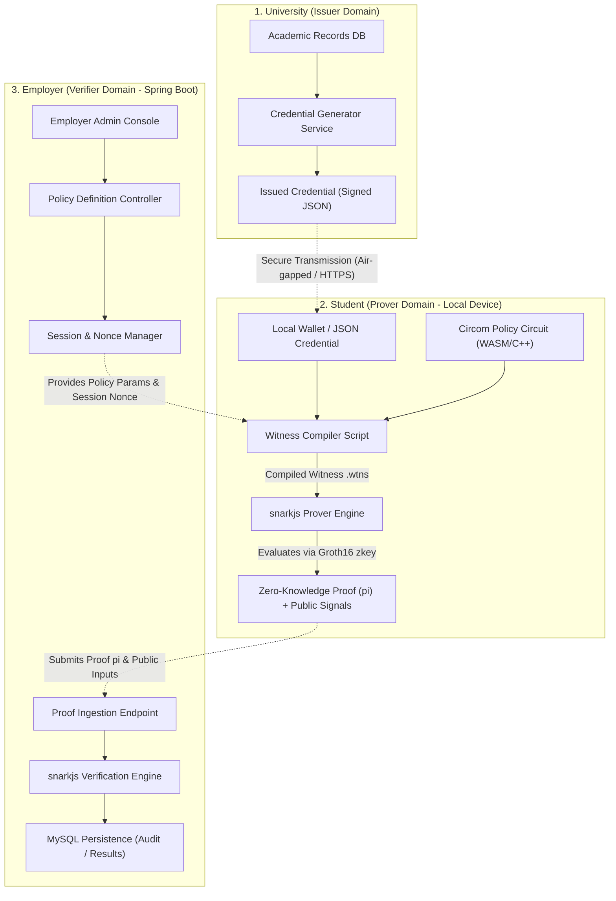
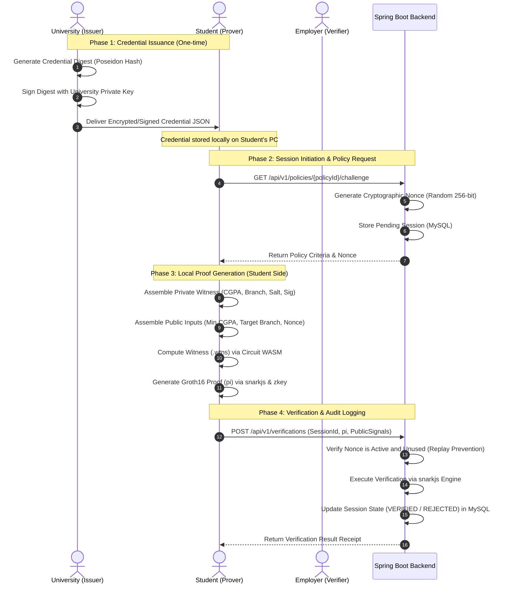
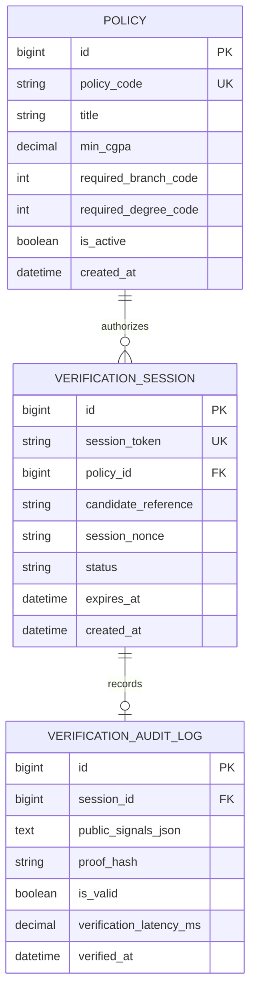

# Policy-Driven Zero-Knowledge Verification for Privacy-Preserving Academic Credentials

[](https://adoptium.net/)
[-brightgreen.svg)](https://spring.io/projects/spring-boot)
[-blue.svg)](https://github.com/iden3/circom)
[-yellow.svg)](https://github.com/iden3/snarkjs)
[](https://eprint.iacr.org/2016/260)
[](#24-development-roadmap-with-task-checklists)

---

## 1. Project Overview

**Policy-Driven Zero-Knowledge Verification for Privacy-Preserving Academic Credentials** is a final-year academic research and engineering project investigating the application of Zero-Knowledge Proofs (ZKPs) to academic eligibility verification.

In conventional verification workflows, confirming basic qualification thresholds—such as whether a candidate possesses a minimum Cumulative Grade Point Average (CGPA) or graduated from a specific department—requires the applicant to submit complete, unredacted transcripts. This practice violates the core privacy principle of **data minimization** (GDPR Article 5(1)(c)), unnecessarily revealing full academic histories, elective course grades, semester backlogs, and sensitive demographic data to external parties who require only a boolean compliance confirmation: *"Does this candidate satisfy eligibility policy $\mathcal{P}$?"*

This project designs and evaluates an enterprise-compatible, privacy-preserving verification system using **Groth16 zk-SNARKs** over the **BN254 (alt_bn128)** elliptic curve, coordinated through a **Spring Boot backend** and **MySQL metadata store**. By compiling eligibility policies into arithmetic circuits executed strictly on the student's personal workstation, the student generates a zero-knowledge proof ($\pi$) demonstrating that their genuine academic records satisfy all required thresholds without disclosing:
1. Their actual numerical CGPA or letter grades.
2. Unrelated course records, transcripts, or personal identification numbers.
3. Intermediate witness values or blinding salts.

The verifier receives solely the proof $\pi$ alongside public policy parameters and a time-bounded challenge nonce, validating compliance cryptographically while private academic attributes remain entirely on the student's local device.

---

## 2. Problem Statement

Modern academic credential verification exhibits three structural challenges:

1. **Transitive Over-Disclosure:** Monolithic transcripts combine all academic history into a single document. Proving a simple eligibility condition (e.g., $\text{CGPA} \ge 7.50$) inadvertently exposes private, granular academic records to recruiters and third-party verifiers.
2. **Centralized Issuer Telemetry:** Digital verification services that require verifiers to query university portals create an unwanted surveillance channel: the issuing institution learns where, when, and how frequently a graduate applies for employment or scholarships.
3. **Selective Disclosure versus Tamper Resistance:** Manual transcript redaction undermines authenticity guarantees, while standard PKI signatures over plain documents do not support selective attribute disclosure or dynamic range proving without revealing underlying plaintext.

**Formal Problem Statement:**  
*How can an academic credential holder prove to a verifier that their university-attested attributes satisfy an arbitrary conjunction of comparison and equality predicates defined by a policy $\mathcal{P}$, such that the verifier gains mathematical certainty of compliance and authenticity, while learning zero knowledge regarding the holder's underlying attributes beyond the truth of the statement?*

---

## 3. Motivation and Objectives

### Motivation
Emerging data protection regulations (e.g., GDPR, India's DPDP Act 2023) mandate privacy by design and storage limitation. Organizations evaluating job candidates face legal exposure when storing unredacted personal transcripts of unsuccessful applicants. Implementing zero-knowledge credential verification enables mathematically backed compliance while eliminating the security liability of holding excess private academic data.

### Primary Objectives
- **Zero-Knowledge Policy Evaluation:** Design Circom circuits enforcing numerical range comparisons ($\text{CGPA} \ge \text{threshold}$) and categorical equalities ($\text{Branch} = \text{Target}$, $\text{Degree} = \text{Target}$) over finite fields.
- **Strict Client-Side Witness Execution:** Maintain all private credential records, blinding salts, and witness compilation tools strictly on the student device.
- **Cryptographic Replay and Session Binding:** Implement cryptographic challenge-response mechanisms binding proofs to single-use verifier nonces to prevent proof replay and front-running.
- **Enterprise Verification Orchestration:** Implement a Spring Boot backend managing policy lifecycles, session issuance, and proof verification.
- **Empirical Performance Evaluation:** Benchmark circuit constraint counts, prover latency, memory footprint, and verification throughput across varying policy complexities.

---

## 4. Proposed Solution

The architecture establishes a decoupled, three-party verification model using **Groth16 zk-SNARKs** over the pairing-friendly **BN254 (alt_bn128)** curve:

```
+--------------------------------------------------------------------------------------------------+
|                                    PROPOSED SYSTEM OVERVIEW                                      |
+--------------------------------------------------------------------------------------------------+
                                                                                                    
   +--------------------+          1. Issues Signed Credential          +--------------------+      
   |     UNIVERSITY     | --------------------------------------------> |      STUDENT       |      
   |     (Issuer)       |           (Offline / Tamper-Proof)            |  (Holder / Prover) |      
   +--------------------+                                               +--------------------+      
                                                                                   |                
                                                                                   | 3. Computes    
                                                                                   |    Private     
                                      2. Fetch Policy & Session Nonce              |    Witness     
                                 <---------------------------------------+         |    & Generates 
                                 |                                       |         |    Proof (pi)  
                                 v                                       |         v    Locally     
                        +--------------------+                           |   [ Circom Circuit ]     
                        |      EMPLOYER      |                           |   [ snarkjs Prover ]     
                        |     (Verifier)     |                           |         |                
                        +--------------------+                           |         |                
                                 ^                                       |         |                
                                 |          4. Submits Proof pi          |         |                
                                 |             & Public Inputs           |         |                
                                 +---------------------------------------+---------+                
                                 |                                                                  
                                 v                                                                  
                    [ Spring Boot Backend ]                                                         
                    [ Verification Engine ] ---> Validates pi via Pairing in O(1) Time              
                    [ MySQL Storage ]       ---> Logs Audit State & Invalidates Nonce               
```

- **Credential Representation:** Academic credentials are structured local JSON documents containing numerical/categorical attributes, university signatures, and blinding salts.
- **Client-Side Prover (Student):** The student compiles private credentials and public parameters into an R1CS witness, executing `snarkjs` locally to generate proof $\pi$.
- **Backend Verifier (Employer):** A Spring Boot REST service defines eligibility policies, issues time-bounded session nonces, and validates proofs against public inputs and the verification key.

---

## 5. Research Positioning and Research Gap

### Research Positioning
This work is situated in **Applied Cryptography** and **Enterprise Privacy Engineering**. It focuses on integrating established cryptographic primitives (Groth16, Poseidon, BN254) into an enterprise application architecture, deliberately avoiding public blockchains, smart contracts, or tokenized identity ledgers.

### Evaluated Paradigms and Architectural Trade-Offs

| Verification Paradigm | Structural Characteristics | Practical Limitations for Enterprise Academic Use |
| :--- | :--- | :--- |
| **Traditional PKI & Digital Transcripts** | Transcripts digitally signed using X.509 certificates (e.g., signed PDF). | **No Selective Disclosure:** The entire document must be revealed to verify the signature; arithmetic range checks cannot be computed in zero knowledge. |
| **Public Blockchain Credentials** | Anchors credential hashes, DID documents, or Merkle roots to public blockchains (Ethereum, Polygon). | **Unnecessary Overhead & Privacy Exposure:** Public ledger transaction costs, consensus latency, operational complexity, and regulatory friction with GDPR's right to erasure. |
| **Anonymous Credentials (BBS+ / CL)** | Camenisch-Lysyanskaya (CL) or BBS+ signatures supporting selective disclosure. | **Range Check Overhead:** Highly optimized for attribute disclosure and set membership, but dynamic arithmetic inequality checks ($\text{CGPA} \ge 7.50$) require specialized zero-knowledge range protocols that are non-trivial to parameterize compared to general-purpose arithmetic circuits. |
| **General-Purpose zk-SNARK Pipelines** | Standalone Circom circuits demonstrated on academic puzzles or mixers. | **Lack of Enterprise Integration:** Rarely integrated with enterprise service layers (Spring Boot, relational persistence, dynamic challenge session management). |

---

## 6. Related Research Papers and Standards

This project draws upon peer-reviewed literature in zero-knowledge argument systems and algebraic primitives:

1. **Groth, J.** (2016). *"On the Size of Pairing-Based Non-interactive Arguments."* In *EUROCRYPT 2016*, Lecture Notes in Computer Science, vol 9666, pp. 305–326. Springer, Berlin, Heidelberg. [DOI: 10.1007/978-3-662-49896-5_11](https://doi.org/10.1007/978-3-662-49896-5_11).  
   *Relevance:* Defines the Groth16 zk-SNARK construction providing constant-size proofs (3 group elements) and constant pairing-count verification.
2. **Grassi, L., Khovratovich, D., Rechberger, C., Schofnegger, M., & Walch, R.** (2021). *"Poseidon: A New Hash Function for Zero-Knowledge Proof Systems."* In *30th USENIX Security Symposium (USENIX Security 21)*, pp. 519–535. [USENIX Publication Link](https://www.usenix.org/conference/usenixsecurity21/presentation/grassi).  
   *Relevance:* Formulates the Hades permutation-based algebraic hash function over prime fields $\mathbb{F}_r$, minimizing R1CS constraints for in-circuit commitments.
3. **Camenisch, J., & Lysyanskaya, A.** (2001). *"An Efficient System for Non-transferable Anonymous Credentials with Optional Anonymity Revocation."* In *EUROCRYPT 2001*, Lecture Notes in Computer Science, vol 2045, pp. 93–118. Springer, Berlin, Heidelberg. [DOI: 10.1007/3-540-44987-6_7](https://doi.org/10.1007/3-540-44987-6_7).  
   *Relevance:* Foundational formalization of anonymous credential verification and non-transferability principles.
4. **Ben-Sasson, E., Chiesa, A., Genkin, D., Tromer, E., & Virza, M.** (2013). *"SNARKs for C: Verifying Program Executions Succinctly and in Zero Knowledge."* In *CRYPTO 2013*, Lecture Notes in Computer Science, vol 8043, pp. 90–108. Springer, Berlin, Heidelberg. [DOI: 10.1007/978-3-642-40084-1_6](https://doi.org/10.1007/978-3-642-40084-1_6).  
   *Relevance:* Practical realization of Quadratic Arithmetic Programs (QAPs) and non-interactive zero-knowledge toolchains.
5. **Bowe, S., Gabizon, A., & Green, M.** (2018). *"A Multi-party Protocol for Constructing zk-SNARK Parameters (Powers of Tau)."* Cryptology ePrint Archive, Report 2017/1050. [ePrint Link](https://eprint.iacr.org/2017/1050).  
   *Relevance:* Foundation for the universal Phase 1 structured reference string (SRS) ceremonies used by `snarkjs`.
6. **World Wide Web Consortium (W3C).** (2024). *"Verifiable Credentials Data Model v2.0."* W3C Proposed Recommendation. [W3C Technical Report](https://www.w3.org/TR/vc-data-model-2.0/).  
   *Relevance:* Architectural reference for the tripartite Issuer–Holder–Verifier relationship.

---

## 7. High-Level System Architecture



---

## 8. Three-Party Architecture



---

## 9. Detailed Component Responsibilities

### 1. University (Credential Issuer)
- **Attribute Authority:** Maintains canonical student transcript databases.
- **Canonical Vectorization:** Formats academic attributes into scalar field elements over $\mathbb{F}_r$.
- **Digital Attestation:** Signs the credential commitment using the university's private signing key.
- **Direct Delivery:** Transmits signed credentials directly to the student without retaining verifier-specific tracking logs.

### 2. Student (Holder & Prover)
- **Local Storage:** Stores raw credentials, blinding salts, and private keys locally in `prover/credentials/`.
- **Policy Ingestion:** Retrieves public policy criteria ($\text{minCGPA}$, $\text{reqBranch}$) and single-use session nonces from the employer.
- **Witness Compilation:** Evaluates private credential values against circuit constraints to generate an R1CS witness.
- **Proof Generation:** Executes `snarkjs` locally to compute proof $\pi = (A, B, C)$.
- **Proof Dispatch:** Submits the proof and public inputs to the verifier, retaining all raw grades locally.

### 3. Employer (Policy Verifier)
- **Policy Authoring:** Configures specific eligibility thresholds (e.g., $\text{minCGPA} \ge 7.50$, $\text{Branch} = \text{CSE}$) via Spring Boot REST APIs.
- **Session & Nonce Management:** Generates cryptographically secure, time-bounded session nonces stored in MySQL to prevent replay attacks.
- **Cryptographic Verification:** Validates proof $\pi$ against `verification_key.json` and asserts public input matching.
- **Audit Logging:** Records timestamped verification receipts without persisting or viewing raw student grades.

---

## 10. Complete End-to-End Verification Workflow

```
[ UNIVERSITY ]
      |
      | 1. Generates Credential JSON:
      |    - Attributes: { cgpa: 865, branch: 101, degree: 1, salt: 0x3f... }
      |    - Commitment: C = Poseidon(cgpa, branch, degree, salt)
      |    - Signature:  Sig_Univ(C)
      v
[ STUDENT LOCAL WORKSTATION ]
      |
      | 2. Requests active verification session from Employer:
      |    <- Returns: { policyId: "POL-2026-CSE", minCgpa: 750, reqBranch: 101, nonce: 0x9b4... }
      |
      | 3. Prepares Circuit Inputs:
      |    Private Witness: { actual_cgpa: 865, actual_branch: 101, actual_degree: 1, salt, univ_sig }
      |    Public Signals:  { min_cgpa: 750, expected_branch: 101, expected_degree: 1, session_nonce, univ_pk }
      |
      | 4. Compiles Witness & Generates zk-SNARK Proof:
      |    $ node generate_witness.js circuit.wasm input.json witness.wtns
      |    $ snarkjs groth16 prove circuit_final.zkey witness.wtns proof.json public.json
      |
      | 5. Submits Payload: { proof.json, public.json, sessionId }
      v
[ EMPLOYER SPRING BOOT BACKEND ]
      |
      | 6. Validates Session:
      |    - Checks session exists, is PENDING, and within expiration window.
      |    - Asserts public.json matches expected session_nonce & policy parameters.
      |
      | 7. Executes Verification:
      |    $ snarkjs groth16 verify verification_key.json public.json proof.json
      |
      | 8. Database Update:
      |    - Flags session as COMPLETED (nonce consumed).
      |    - Stores verification outcome: SUCCESS / FAILED.
```

---

## 11. Cryptographic Architecture

### Elliptic Curve Setting: BN254 (alt_bn128)
The protocol operates over the pairing-friendly curve $E(\mathbb{F}_q)$ defined by $y^2 = x^3 + 3$, equipped with an optimal Ate pairing:
$$e: G_1 \times G_2 \to G_T$$
where:
- Base field order:
  $$q = 21888242871839275222246405745257275088696311157297823662689037894645226208583$$
- Scalar field (circuit constraint field) order:
  $$r = 21888242871839275222246405745257275088548364400416034343698204186575808495617$$

### Groth16 zk-SNARK Scheme
Circuit relations are expressed as a system of Rank-1 Constraint Systems (R1CS):
$$L(x) \cdot R(x) - O(x) = H(x) \cdot T(x)$$
A valid proof consists of exactly three group elements:
$$\pi = (A \in G_1, \; B \in G_2, \; C \in G_1)$$

#### Proof Size and Serialization Assumptions
The physical size of proof $\pi$ depends directly on the chosen serialization format:
- **Compressed Binary Format:** Points in $G_1$ require 32 bytes (256 bits), and points in $G_2$ (defined over quadratic extension field $\mathbb{F}_{q^2}$) require 64 bytes (512 bits). Under compressed binary serialization, the proof total is:
  $$\text{Size}_{\text{compressed}} = 32 \, (A) + 64 \, (B) + 32 \, (C) = 128 \text{ bytes}$$
- **Uncompressed Binary Format:** Standard affine representation $((x, y) \in \mathbb{F}_q^2$ for $G_1$, and $(x, y) \in (\mathbb{F}_{q^2})^2$ for $G_2$) yields:
  $$\text{Size}_{\text{uncompressed}} = 64 \, (A) + 128 \, (B) + 64 \, (C) = 256 \text{ bytes}$$
- **JSON Serialization (`snarkjs` wire format):** Text-encoded string arrays of decimal coordinates with projective metadata in `proof.json` span approximately **800 to 1,000 bytes**.

#### Detailed Prover and Verifier Algorithmic Complexity
1. **Prover Complexity:** Prover work is partitioned into three distinct computational operations:
   - **Circuit Evaluation (Witness Generation):** Evaluates the R1CS constraint system over $\mathbb{F}_r$ to obtain the complete assignment vector $w$, requiring $\mathcal{O}(|C|)$ field operations.
   - **Polynomial Arithmetic (FFT / NTT):** Performs forward and inverse Fast Fourier Transforms over the roots of unity in $\mathbb{F}_r$ to interpolate constraint polynomials and compute quotient $H(x)$, requiring $\mathcal{O}(|C| \log |C|)$ field operations.
   - **Multi-Scalar Multiplication (MSM):** Computes group elements in $G_1$ and $G_2$ as linear combinations of proving key bases. Using Pippenger's algorithm, this requires $\mathcal{O}\left(\frac{|C|}{\log |C|}\right)$ group additions and doublings. In practice, elliptic-curve group operations are two to three orders of magnitude more expensive than field operations, making MSM the dominant wall-clock bottleneck during proof generation.
2. **Verifier Complexity:** Verification work consists of two operations:
   - **Public Input Linear Combination:** Evaluates the public inputs vector $x = (x_0, \dots, x_\ell)$ by computing the multiexponentiation $\sum_{i=0}^{\ell} x_i \cdot \gamma_i \in G_1$. This scales linearly with the number of public inputs $\ell$, requiring $\mathcal{O}(\ell)$ group operations in $G_1$.
   - **Pairing Checks:** Computes exactly three bilinear pairings (or a single 4-term multi-pairing identity):
     $$e(A, B) = e(\alpha, \beta) \cdot e\left(\sum_{i=0}^{\ell} x_i \cdot \gamma_i, \; \gamma\right) \cdot e(C, \delta)$$
     Crucially, the number of pairing evaluations is constant ($\mathcal{O}(1)$) and completely independent of the circuit size $|C|$.

### Poseidon Algebraic Hash Function
Standard hash functions (SHA-256) incur approximately $\approx 25,000$ R1CS constraints per invocation due to bitwise boolean operations. This project uses **Poseidon** over $\mathbb{F}_r$, using an $S$-box of degree $x^5$ ($\gcd(5, r-1) = 1$):
- Full rounds ($R_F = 8$) and partial rounds ($R_P = 57$).
- Consumes approximately $\approx 240 - 350$ constraints per hash invocation.

---

## 12. Public Inputs and Private Witnesses

| Variable Name | Classification | Domain | Cryptographic Purpose |
| :--- | :--- | :--- | :--- |
| `actual_cgpa` | **Private Witness** | $\mathbb{F}_r$ (Scaled: $8.65 \to 865$) | Student's true numerical CGPA. Kept strictly private on client. |
| `actual_branch` | **Private Witness** | $\mathbb{F}_r$ (Numeric Enum: `CSE` $\to 101$) | Actual academic department/branch. Kept private. |
| `actual_degree` | **Private Witness** | $\mathbb{F}_r$ (Numeric Enum: `BE` $\to 1$) | Actual degree conferred. Kept private. |
| `credential_salt` | **Private Witness** | $\mathbb{F}_r$ (256-bit random scalar) | High-entropy blinding salt preventing dictionary pre-image attacks. |
| `issuer_sig_r` | **Private Witness** | $\mathbb{F}_r$ (Curve point scalar) | University signature $R$ component (Milestone 2 candidate). |
| `issuer_sig_s` | **Private Witness** | $\mathbb{F}_r$ (Curve point scalar) | University signature $S$ component (Milestone 2 candidate). |
| `min_cgpa` | **Public Input** | $\mathbb{F}_r$ (Scaled: $7.50 \to 750$) | Employer-specified minimum GPA threshold. |
| `expected_branch` | **Public Input** | $\mathbb{F}_r$ (Numeric Enum: `101`) | Employer-specified required branch. |
| `expected_degree` | **Public Input** | $\mathbb{F}_r$ (Numeric Enum: `1`) | Employer-specified required degree. |
| `session_nonce` | **Public Input** | $\mathbb{F}_r$ (256-bit fresh nonce) | Cryptographic challenge issued by Employer for replay prevention. |
| `issuer_pubkey_x` | **Public Input** | $\mathbb{F}_r$ (Curve coordinate) | Public key of the issuing institution. |
| `issuer_pubkey_y` | **Public Input** | $\mathbb{F}_r$ (Curve coordinate) | Public key of the issuing institution. |

---

## 13. Policy Circuit and Mathematical Representation

### Integer Scaling and Strict Range Enforcement
Finite fields $\mathbb{F}_r$ operate on integer modular arithmetic and do not support IEEE-754 floating-point numbers. To ensure precision, all GPA values adopt **$10^2$ fixed-point integer scaling**:
$$\text{scaled\_cgpa} = \lfloor \text{actual\_cgpa} \times 100 \rfloor \quad (\text{e.g., } 8.65 \implies 865)$$
$$\text{scaled\_min\_cgpa} = \lfloor \text{min\_cgpa} \times 100 \rfloor \quad (\text{e.g., } 7.50 \implies 750)$$

#### Explicit Domain Range Constraints
Valid CGPA values belong strictly to the real domain $[0.00, 10.00]$, corresponding to scaled integers in $[0, 1000]$. The circuit explicitly enforces:
$$0 \le \text{scaled\_cgpa} \le 1000$$
$$0 \le \text{scaled\_min\_cgpa} \le 1000$$

#### Inequality Enforcement and Anti-Wrap-Around Protection
To prove $A \ge B$ without revealing $A$, the circuit computes $\Delta = A - B$ and verifies that $\Delta \ge 0$.  
In modular arithmetic over prime field $\mathbb{F}_r$, if $A < B$, the naive subtraction wraps around modulo $r$:
$$A - B \equiv r - (B - A) \pmod r$$
Because $r \approx 2^{254}$, this negative difference wraps to a massive positive field element. To prevent underflow exploitability, the circuit enforces a strict **$k$-bit binary decomposition** where $k = 10$ bits ($2^{10} = 1024 > 1000$):
$$\Delta = \sum_{i=0}^{9} b_i \cdot 2^i \quad \text{such that} \quad b_i \cdot (1 - b_i) = 0, \; \forall i \in \{0, \dots, 9\}$$
If $A < B$, $\Delta \ge 2^{10}$, making binary decomposition impossible within 10 bits and causing the constraint solver to reject witness generation.

#### Categorical Equalities and Session Binding
$$\text{Constraint}_{\text{branch}}: (\text{actual\_branch} - \text{expected\_branch}) = 0$$
$$\text{Constraint}_{\text{degree}}: (\text{actual\_degree} - \text{expected\_degree}) = 0$$
$$\text{PolicyHash} = \text{Poseidon}(\text{scaled\_min\_cgpa}, \text{expected\_branch}, \text{expected\_degree})$$
$$\text{SessionBinding} = \text{Poseidon}(\text{PolicyHash}, \text{session\_nonce})$$

---

## 14. Credential Authenticity and Issuer-Signature Architecture

A zero-knowledge proof of attribute eligibility is meaningless if the prover can execute the circuit over fabricated inputs. The circuit must verify that the private inputs were attested by an authorized University.

### Preferred Architecture Under Investigation: EdDSA over BabyJubjub
The preferred candidate architecture under active research is **EdDSA signatures over the BabyJubjub curve** verified in-circuit using Poseidon hash commitments.

```
                      +------------------------------------------+
                      |         STUDENT PRIVATE CREDENTIAL       |
                      |  cgpa, branch, degree, credential_salt   |
                      +------------------------------------------+
                                           |
                                           v
                             [ Poseidon Hash Primitive ]
                                           |
                                           v
                             Root Commitment Hash (C)
                                           |
                      +--------------------+---------------------+
                      |                                          |
                      v                                          v
      [ University Signed Digest ]               [ In-Circuit Signature Check ]
      Sig_Univ = Sign(SK_Univ, C)                 Assert: VerifySig(PK_Univ, C, Sig) == 1
```

### Why Plain Hashing or Symmetric HMACs are Insufficient
1. **Unkeyed Poseidon Hash:** Poseidon is a public, unkeyed algebraic function. Without an asymmetric signature, a malicious student could hash fabricated attributes and construct a valid proof over their own self-generated commitment.
2. **Symmetric HMAC Inadequacy:** An HMAC requires a shared symmetric secret key. If the University and verifier shared an HMAC key, the verifier could forge student credentials, completely invalidating non-repudiation and breaking the decoupled three-party trust model.
3. **Asymmetric EdDSA over BabyJubjub:** BabyJubjub is a twisted Edwards curve whose base field matches the scalar field $\mathbb{F}_r$ of BN254. This allows asymmetric signature verification inside Circom in $\approx 3,500$ constraints, whereas standard secp256k1 ECDSA requires over $\approx 1.5$ million constraints.

*(Status: Signature verification inside the circuit is designated as a dedicated upcoming task under Milestone 2).*

---

## 15. Security, Privacy, and Non-Transferability Analysis

### Cryptographic Security Properties
- **Completeness:** An honest prover possessing an authentic, compliant credential will always produce a proof $\pi$ that satisfies verification.
- **Computational Soundness:** A computationally bounded adversary possessing non-compliant attributes cannot produce a valid proof $\pi^*$, except with negligible probability $\epsilon \le \mathcal{O}(d/r)$.
- **Zero-Knowledge:** The proof $\pi$ reveals no information regarding private inputs $(\text{actual\_cgpa}, \text{branch}, \text{degree}, \text{salt})$ beyond the truth of the statement.

### Nuance: Proof Transferability vs. Session Binding
Ordinary zero-knowledge proofs (including Groth16) are **publicly verifiable and transferable by default**: anyone possessing proof $\pi$ and valid public inputs can confirm its validity.

This project implements **Replay Protection and Session Binding**, not inherent cryptographic non-transferability:
- **Session Binding:** Binds the proof to a single-use session nonce $N_s$ generated by a specific verifier.
- **Replay Protection:** Prevents an adversary from intercepting and re-submitting an already-evaluated proof.
- **Protocol Limitations:** Session challenge binding does **not** prevent a colluding student from voluntarily sharing their raw credential file or private keys with another individual (the credential-sharing problem). Achieving true non-transferability requires Designated Verifier Proofs (DVPs) or hardware-isolated private keys (e.g., TPM / WebAuthn enclaves), which are documented as future research directions.

---

## 16. Threat Model

| Threat Vector | Adversary Objective | System Countermeasure & Invariant |
| :--- | :--- | :--- |
| **Grade Tampering** | Candidate with CGPA = 6.80 attempts to prove CGPA $\ge 7.50$. | **Soundness of 10-bit R1CS Decomposition:** Constraint $\Delta = A - B \ge 0$ causes integer wrap-around modulo $r$; cannot satisfy 10-bit binary decomposition. |
| **Credential Forgery** | Candidate constructs arbitrary attributes without university attestation. | **Asymmetric Signature Constraint:** Circuit checks that attribute commitment matches a valid university signature under public key $\text{PK}_{\text{Univ}}$. |
| **Eavesdropping Replay** | Attacker intercepts a peer's proof $\pi$ and submits it to another employer. | **Single-Use Session Nonce:** Proof incorporates a verifier-generated challenge nonce $N_s$. Re-submissions of expired or unrecognized nonces are rejected by the backend. |
| **Dictionary Inversion** | Verifier attempts to invert low-entropy fields (e.g., branch codes 1..50). | **Cryptographic Blinding Salt:** Attributes are hashed together with a high-entropy 256-bit random salt, rendering brute-force inversion computationally infeasible. |
| **Public Input Tampering** | Attacker modifies policy parameters in transit. | **Pairing Identity Invalidation:** Public signals directly parameterize the verification equation; modifying any signal invalidates the pairing check $e(A, B) = \dots$. |

---

## 17. Database Design



---

## 18. Technology Stack

| Layer / Role | Technology | Target / Configured Version | Purpose |
| :--- | :--- | :--- | :--- |
| **Prover Circuits** | Circom | `2.2.3` | Compiles arithmetic constraint circuits to R1CS and C++/WASM witness generators. |
| **ZKP Framework** | snarkjs | `0.7.6` | Powers of Tau ceremony, witness calculation, Groth16 proving and verification. |
| **Curve & Cryptography** | BN254 / Poseidon | Standard | Pairing-friendly elliptic curve and algebraic hashing over $\mathbb{F}_r$. |
| **Backend Runtime** | Eclipse Temurin JDK | `21.0.13+9 LTS` | User-level runtime executing Maven and future Spring Boot backend services. |
| **Backend Framework** | Spring Boot | `3.x (Planned)` | Orchestrates policies, session nonces, verification endpoints, and audit records. |
| **Database Engine** | MySQL Server | `8.0.34 (Installed)` | Stores verification sessions, policy parameters, and benchmark audit logs. |
| **Build & Tooling** | Apache Maven | `3.9.9 (Bundled)` | Headless build tool bundled with IntelliJ IDEA; planned Maven Wrapper (`mvnw`). |
| **Client Execution** | Node.js / npm | `v22.7.0` / `10.8.2` | Executes client-side proof generation scripts and snarkjs CLI. |

---

## 19. Research Methodology

```
+--------------------------------------------------------------------------------------------------+
|                                    RESEARCH METHODOLOGY PHASES                                   |
+--------------------------------------------------------------------------------------------------+
                                                                                                    
  [ Phase 1: Cryptographic Modeling ]                                                               
  - Define R1CS arithmetic predicates for threshold checks and categorical equality.               
  - Select 10^2 scaling factor and 10-bit decomposition limits to avoid modular wrap-around.        
  - Formulate Poseidon-based credential commitments and session nonce binding.                     
                                   |                                                                
                                   v                                                                
  [ Phase 2: Circuit Implementation & Ceremony ]                                                    
  - Author Circom circuits: policy_verifier.circom, comparators.circom, hash_commitment.circom.     
  - Execute Phase 1 Powers of Tau ceremony and Phase 2 circuit-specific Groth16 setup.              
  - Export verification_key.json and compiled WASM witness generator.                               
                                   |                                                                
                                   v                                                                
  [ Phase 3: Prover CLI & Backend Development ]                                                     
  - Construct student-side CLI prover scripts in Node.js/snarkjs.                                   
  - Implement Spring Boot REST services for policy management and verification session orchestration.
  - Configure MySQL schema migrations and persistence layer.                                       
                                   |                                                                
                                   v                                                                
  [ Phase 4: Empirical Evaluation & Benchmarking ]                                                  
  - Profile circuit constraint counts across 1, 2, 4, and 8 policy predicates.                     
  - Measure prover memory usage, proof generation latency, and backend verification time.           
  - Perform security penetration tests (replay attacks, invalid inputs, signature bypass attempts). 
```

---

## 20. Experimental Evaluation Metrics

1. **Circuit Complexity:** Total R1CS linear constraints ($|C|$), non-linear constraints, private witness signals, and public signals.
2. **Prover Resource Consumption:**
   - Witness generation time ($T_{\text{witness}}$ in ms).
   - FFT/NTT polynomial evaluation latency ($T_{\text{FFT}}$ in ms).
   - Multi-scalar multiplication latency ($T_{\text{MSM}}$ in ms).
   - Peak resident memory (RAM) on consumer-grade student devices.
3. **Proof Artifact Size:** Serialized payload across compressed binary, uncompressed binary, and JSON wire formats.
4. **Verifier Throughput:**
   - Public input linear combination latency ($T_{\text{MSM, pub}}$ in ms).
   - Pairing evaluation time ($T_{\text{pairing}}$ in ms).
   - End-to-end REST verification latency through Spring Boot.

---

## 21. Computational Complexity Analysis

| Operation | Entity | Computational Breakdown | Asymptotic Complexity | Typical Empirical Magnitude |
| :--- | :--- | :--- | :--- | :--- |
| **Witness Generation** | Prover (Student) | Constraint evaluation over field $\mathbb{F}_r$ | $\mathcal{O}(|C|)$ | $\sim 50 - 150 \text{ ms}$ |
| **FFT / Polynomials** | Prover (Student) | Forward / Inverse NTT over roots of unity | $\mathcal{O}(|C| \log |C|)$ field ops | $\sim 200 - 600 \text{ ms}$ |
| **Multi-Scalar Mult (MSM)** | Prover (Student) | Pippenger multiexponentiation in $G_1, G_2$ | $\mathcal{O}\left(\frac{|C|}{\log |C|}\right)$ group ops | $\sim 600 - 2000 \text{ ms}$ |
| **Prover Memory** | Prover (Student) | Storing constraint polynomials and evaluations | $\mathcal{O}(|C|)$ | $\sim 80 - 250 \text{ MB}$ |
| **Proof Payload** | Channel | 3 curve elements ($A \in G_1, B \in G_2, C \in G_1$) | $\mathcal{O}(1)$ | **128 B** (compressed) / **256 B** (uncompressed) / $\sim \mathbf{900 B}$ (JSON) |
| **Verifier Multi-Scalar** | Verifier (Employer) | Public inputs multiexponentiation $\sum x_i \gamma_i$ | $\mathcal{O}(\ell)$ group ops in $G_1$ | $\sim 0.2 - 0.5 \text{ ms}$ |
| **Verifier Pairings** | Verifier (Employer) | Evaluating 3 Ate bilinear pairings | $\mathcal{O}(1)$ pairing evaluations | $\sim 2 - 5 \text{ ms}$ (Constant w.r.t $|C|$) |

---

## 22. Expected Research Contributions

1. **Enterprise Zero-Knowledge Architecture:** Practical, non-blockchain credential verification framework avoiding public ledger gas costs and regulatory data storage conflicts.
2. **Reusable Policy Parameterization:** Circuit architecture allowing dynamic employer policy thresholds without requiring new trusted setup ceremonies for each criteria modification.
3. **Cryptographic Replay Resistance:** Formal integration of single-use challenge nonces into SNARK public inputs, preventing proof interception and unauthorized re-use.
4. **Empirical Benchmarks:** Comprehensive performance and constraint profiling on consumer hardware, proving the viability of client-side ZKP generation for higher education applications.

---

## 23. Testing Strategy

```
+--------------------------------------------------------------------------------------------------+
|                                    FOUR-TIER TESTING STRATEGY                                    |
+--------------------------------------------------------------------------------------------------+

  [ Tier 1: Circuit Constraint Tests (Mocha / Chai / Circom Tester) ]
  * Positive test: Prover with CGPA = 865 satisfies threshold 750.
  * Negative test: Prover with CGPA = 749 fails constraint satisfaction.
  * Boundary test: Prover with CGPA = 750 exactly satisfies threshold.
  * Bit-overflow test: Prover difference exceeding 10-bit decomposition triggers constraint failure.

  [ Tier 2: Cryptographic Security Tests (Negative Test Suite) ]
  * Replay Attack: Re-submitting proof pi with a stale nonce N_s must fail.
  * Front-Running: Modifying public inputs while retaining proof pi must fail pairing check.
  * Forgery Test: Proof generated with random salt and invalid signature fails verification.

  [ Tier 3: Backend API Integration Tests (Spring Boot Test / JUnit 5 / Testcontainers) ]
  * Policy lifecycle management (CRUD).
  * Session generation and expiration enforcement.
  * snarkjs wrapper execution and response parsing.

  [ Tier 4: End-to-End System Tests ]
  * Full pipeline execution: Credential Creation -> Prover CLI -> REST API -> MySQL Update.
```

---

## 24. Development Roadmap with Task Checklists

### Milestone 1: Environment Inspection, JDK Setup & Repository Foundation
- [x] **Inspected:** Audited local development environment (Node.js v22.7.0, npm 10.8.2, Git 2.36.1, MySQL 8.0.34 binaries on disk; confirmed Circom and snarkjs absent).
- [x] **Completed:** Established clean repository folder layout (`backend/`, `circuits/`, `prover/`, `docs/`, `experiments/`).
- [x] **Completed:** Created comprehensive root `.gitignore` covering Java, Node.js, and ZKP build artifacts.
- [x] **Configured & Tested:** Downloaded, verified SHA-256 (`a4dbaa...`), and extracted Eclipse Temurin JDK 21 LTS (`jdk-21.0.13+9`) to `C:\Users\admin\Development\Java\jdk-21`.
- [x] **Configured & Tested:** Configured user-level `JAVA_HOME` and user-level `PATH` in Windows registry (`HKCU\Environment`).
- [x] **Configured & Tested:** Verified that IntelliJ-bundled Maven 3.9.9 executes successfully under `JAVA_HOME` targeting JDK 21.0.13 LTS.
- [x] **Documented:** Analyzed Windows composite PATH resolution (System PATH precedence over User PATH in generic non-session shells due to machine-level Oracle javapath shim).

### Milestone 2: Circuit Design, Range Checks & Trusted Setup *(Upcoming)*
- [ ] Implement `comparators.circom` with 10-bit binary decomposition range checks.
- [ ] Implement `policy_verifier.circom` with $10^2$ scaled GPA comparisons and categorical equality checks.
- [ ] Implement Poseidon hash commitments for attribute binding.
- [ ] Investigate and integrate EdDSA signature verification over BabyJubjub.
- [ ] Execute Powers of Tau ceremony (bn128) and generate proving key (`circuit_final.zkey`).
- [ ] Export `verification_key.json` and generate circuit WASM witness generators.

### Milestone 3: Student Prover Tooling
- [ ] Implement credential generation utility for mock university attestation.
- [ ] Develop student-side CLI runner in `prover/` to parse local JSON credentials.
- [ ] Implement automated witness calculation and proof generation script.
- [ ] Package student payload generator producing standardized `{ proof, public_signals }` payloads.

### Milestone 4: Spring Boot Backend & Database Integration
- [ ] Initialize Spring Boot 3.x backend application with Maven Wrapper.
- [ ] Define MySQL entities for policies, verification sessions, and audit receipts.
- [ ] Implement REST endpoints:
  - `POST /api/v1/policies` — Author eligibility policy.
  - `POST /api/v1/sessions` — Issue fresh challenge nonce.
  - `POST /api/v1/verify` — Accept and verify submitted proof payload.
- [ ] Implement verification service wrapping `snarkjs` / pairing engine.

### Milestone 5: Empirical Benchmarking & Research Publication
- [ ] Build automated benchmarking harness in `experiments/`.
- [ ] Record prover execution time, memory usage, and constraint counts across varying policy sizes.
- [ ] Author formal research project report and documentation.

---

## 25. Project Scope and Limitations

### In Scope
- Verification of numerical thresholds (CGPA) and categorical values (Branch, Degree) in zero knowledge.
- Local, client-side proof generation on standard student personal computers.
- Single-use session nonce protocol preventing proof replay and front-running.
- Spring Boot enterprise backend service with MySQL persistence.

### Out of Scope & Limitations
- **No Blockchain / Distributed Ledger:** The project deliberately avoids smart contracts, token incentives, and blockchain state to ensure privacy, performance, and legal compliance (GDPR).
- **Trusted Setup Dependency:** Groth16 requires a circuit-specific structured reference string (SRS) generated via a multi-party computation (MPC) ceremony. A compromised setup compromises soundness.
- **Credential Sharing Limitation:** Session binding stops proof interception and replay, but does not prevent a student from voluntarily sharing their private raw credentials or signing keys with another party.
- **Single Credential per Proof:** Current circuit scope verifies credentials issued under a single university schema; cross-institutional multi-credential joins are reserved for future iterations.

---

## 26. Expected Final Outcome

Upon completion, the project will deliver:
1. **A Fully Verifiable Zero-Knowledge Circuit Suite:** Production-ready Circom circuits compiling to under 1,500 R1CS constraints, ensuring proof generation times under 2 seconds on consumer laptops.
2. **Student Prover Suite:** A standalone, privacy-preserving command-line tool allowing students to prove eligibility locally from an encrypted or JSON credential file.
3. **Employer Verification Platform:** A high-performance Spring Boot service capable of issuing challenge sessions and validating academic proofs in under 5 milliseconds.
4. **Empirical Research Dataset:** Comprehensive benchmark logs and graphs comparing proof generation overhead, memory constraints, and verification latencies.

---

## 27. Future Research Directions

- **Universal SNARK Migration (PLONK / Halo2):** Eliminating circuit-specific trusted setups by migrating from Groth16 to universal SRS schemes (PLONK) or transparent setups (Halo2 / IPA).
- **Designated Verifier Proofs (DVPs):** Exploring designated verifier proofs to achieve true cryptographic non-transferability without requiring hardware-isolated secure enclaves.
- **Post-Quantum ZKP Integration:** Investigating STARKs (Scalable Transparent Arguments of Knowledge) based solely on collision-resistant hash functions to provide post-quantum security against Shor's algorithm.
- **Cryptographic Revocation Accumulators:** Integrating cryptographic accumulators (e.g., Merkle trees or bilinear accumulators) to support instant credential revocation without centralized verifier queries.

---

## 28. Repository Structure

```
Academic-ZKP-Verification/
├── backend/                            # Spring Boot verification & policy service (Milestone 4)
│   ├── src/main/java/                  # Backend controllers, services, repositories
│   ├── src/main/resources/             # application.yml, database schema migrations
│   └── pom.xml                         # Maven build configuration
│
├── circuits/                           # Circom zero-knowledge circuit definitions (Milestone 2)
│   ├── templates/                      # Modular circuit templates (comparators, hashers)
│   ├── policy_verifier.circom          # Main academic policy verification circuit
│   ├── build/                          # Compiled R1CS, sym, and WASM generators
│   └── setup/                          # Powers of Tau, zkey files, verification_key.json
│
├── prover/                             # Student-side proof generation tooling (Milestone 3)
│   ├── credentials/                    # Mock local credentials (gitignored private data)
│   ├── generate_proof.js               # CLI script compiling witness and executing snarkjs
│   └── package.json                    # Local npm dependencies (snarkjs)
│
├── docs/                               # Research documentation & architecture decisions
│   ├── design-decisions/               # Architectural Decision Records (ADRs)
│   └── research-notes/                 # Literature surveys, cryptographic math derivations
│
├── experiments/                        # Benchmarking & performance evaluation (Milestone 5)
│   ├── benchmarks/                     # Execution time & memory profiling scripts
│   └── results/                        # CSV logs, constraint tables, and latency plots
│
├── .gitignore                          # Excludes build outputs, keys, and private credentials
└── README.md                           # Comprehensive project research documentation
```

---

## 29. Research References

1. **Groth, J.** (2016). *On the Size of Pairing-Based Non-interactive Arguments.* In: International Conference on the Theory and Applications of Cryptographic Techniques (EUROCRYPT 2016), Lecture Notes in Computer Science, vol 9666, pp. 305–326. Springer, Berlin, Heidelberg. [https://doi.org/10.1007/978-3-662-49896-5_11](https://doi.org/10.1007/978-3-662-49896-5_11).
2. **Grassi, L., Khovratovich, D., Rechberger, C., Schofnegger, M., & Walch, R.** (2021). *Poseidon: A New Hash Function for Zero-Knowledge Proof Systems.* In: 30th USENIX Security Symposium (USENIX Security 21), pp. 519–535. [https://www.usenix.org/conference/usenixsecurity21/presentation/grassi](https://www.usenix.org/conference/usenixsecurity21/presentation/grassi).
3. **Camenisch, J., & Lysyanskaya, A.** (2001). *An Efficient System for Non-transferable Anonymous Credentials with Optional Anonymity Revocation.* In: International Conference on the Theory and Applications of Cryptographic Techniques (EUROCRYPT 2001), Lecture Notes in Computer Science, vol 2045, pp. 93–118. Springer, Berlin, Heidelberg. [https://doi.org/10.1007/3-540-44987-6_7](https://doi.org/10.1007/3-540-44987-6_7).
4. **Ben-Sasson, E., Chiesa, A., Genkin, D., Tromer, E., & Virza, M.** (2013). *SNARKs for C: Verifying Program Executions Succinctly and in Zero Knowledge.* In: Advances in Cryptology – CRYPTO 2013, Lecture Notes in Computer Science, vol 8043, pp. 90–108. Springer, Berlin, Heidelberg. [https://doi.org/10.1007/978-3-642-40084-1_6](https://doi.org/10.1007/978-3-642-40084-1_6).
5. **Bowe, S., Gabizon, A., & Green, M.** (2018). *A Multi-party Protocol for Constructing zk-SNARK Parameters (Powers of Tau).* Cryptology ePrint Archive, Report 2017/1050. [https://eprint.iacr.org/2017/1050](https://eprint.iacr.org/2017/1050).
6. **iden3.** (2023). *Circom 2.0: Modern Zero-Knowledge Circuit Compiler.* iden3 Documentation. [https://docs.circom.io/](https://docs.circom.io/).
7. **iden3.** (2023). *snarkjs: JavaScript Implementation of zk-SNARKs.* GitHub Repository. [https://github.com/iden3/snarkjs](https://github.com/iden3/snarkjs).
8. **World Wide Web Consortium (W3C).** (2024). *Verifiable Credentials Data Model v2.0.* W3C Proposed Recommendation. [https://www.w3.org/TR/vc-data-model-2.0/](https://www.w3.org/TR/vc-data-model-2.0/).
