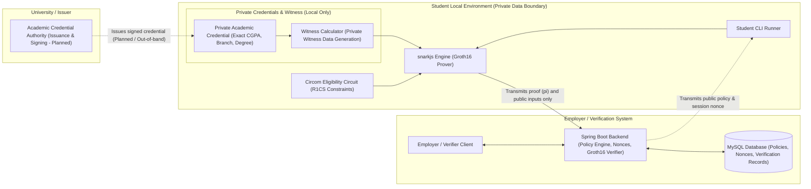

# Policy-Driven Zero-Knowledge Verification for Privacy-Preserving Academic Credentials

[-brightgreen.svg)](https://spring.io/projects/spring-boot)
[-blue.svg)](https://github.com/iden3/circom)
[-yellow.svg)](https://github.com/iden3/snarkjs)

---

## 1. Project Overview

**Policy-Driven Zero-Knowledge Verification for Privacy-Preserving Academic Credentials** is a research and software engineering project investigating the application of Zero-Knowledge Proofs (ZKPs) to academic eligibility verification.

In conventional hiring and admissions workflows, applicants must submit complete, unredacted transcripts to prove basic eligibility (such as a minimum CGPA, qualifying branch, or degree type). This practice leads to **systemic over-disclosure**, unnecessarily revealing detailed course histories, semester-by-semester grades, backlogs, and sensitive personal identifiers to third parties who require only a boolean compliance confirmation: *"Does this candidate satisfy eligibility policy $\mathcal{P}$?"*

This project develops a privacy-preserving verification system using **Groth16 zk-SNARKs** over the **BN254 (alt_bn128)** elliptic curve, coordinated by a **Spring Boot** backend with **MySQL** storage. Candidates execute arithmetic circuits locally on their personal machines, producing a succinct zero-knowledge proof ($\pi$) confirming that their academic qualifications satisfy employer-defined thresholds without disclosing:
- Their exact numerical CGPA, letter grades, or failed course records.
- Irrelevant personal identification numbers or transcript details.
- Secret witness values.

All private academic attributes remain strictly within the student's local environment. The employer receives only the cryptographic proof and declared public inputs, verifying eligibility via $\mathcal{O}(\ell)$ public-input scalar multiplications and a constant count ($\mathcal{O}(1)$) of pairing operations without accessing the underlying transcript.

---

## 2. Problem and Proposed Solution

### The Problem
- **Over-Disclosure:** Full transcripts violate the principle of data minimization (GDPR Art. 5(1)(c)). Employers store excessive personal academic history for candidates they do not hire, creating unnecessary data liability.
- **Centralized Tracking:** Traditional online verification platforms require employers to query issuing university portals directly, creating a centralized tracking trail of where and when graduates apply.
- **Selective Disclosure Dilemma:** Document redaction invalidates digital signatures, while standard digital signatures over plaintext records lack selective attribute disclosure and range-proving capabilities.

### The Proposed Solution
A decoupled, three-party verification model that enforces zero-knowledge privacy without requiring public blockchains, smart contracts, or distributed ledgers:
- **University (Issuer):** Generates and digitally signs student academic credentials (issuance and in-circuit signature verification planned / under investigation).
- **Student (Holder / Prover):** Holds credentials locally in private JSON files and runs a local CLI to compute witness data and generate zero-knowledge proofs.
- **Employer / Verification System:** Runs a Spring Boot backend that defines eligibility policies, issues time-bounded session nonces, verifies incoming proofs, and stores metadata in MySQL.

---

## 3. System Architecture

The following component architecture diagram illustrates the system boundaries, data flows, and trust domains. All private credentials, raw grades, and witness data remain strictly within the student's local environment.

---

## 4. Technology Stack

| Layer | Technology | Target Version | Architectural Role |
| :--- | :--- | :--- | :--- |
| **Circuit Compiler** | Circom | `2.2.3` | Compiles arithmetic constraint circuits to R1CS and C++/WASM witness generators. |
| **ZKP Framework** | snarkjs | `0.7.6` | Trusted setup execution, witness calculation, Groth16 proving, and verification. |
| **Curve & Cryptography** | BN254 / Poseidon | Standard | Pairing-friendly elliptic curve and algebraic hash function over scalar field $\mathbb{F}_r$. |
| **Backend Runtime** | Eclipse Temurin JDK | `21.0.13+9 LTS` | User-space Java runtime configured for backend service execution. |
| **Backend Framework** | Spring Boot | `3.x (Planned)` | REST endpoints for policy management, session nonces, and proof verification. |
| **Database Engine** | MySQL Server | `8.0.34 (Installed)` | Relational persistence for policy rules, single-use nonces, and audit receipts. |
| **Build Tooling** | Apache Maven | `3.9.9 (Bundled)` | Build tool bundled with IntelliJ IDEA; planned Maven Wrapper (`mvnw`). |
| **Prover CLI Runtime** | Node.js / npm | `v22.7.0` / `10.8.2` | Client-side execution environment for witness compilation and proof generation scripts. |

---

## 5. Privacy and Security

### Fixed-Point CGPA Representation and Range Checks
Finite fields $\mathbb{F}_r$ operate on modular arithmetic. To represent fractional grades without floating-point errors, all CGPA values use **$10^2$ fixed-point integer scaling**:

$$
\text{scaled}\_\text{cgpa} = \lfloor \text{actual}\_\text{cgpa} \times 100 \rfloor \quad (\text{e.g., } 8.65 \implies 865, \quad 7.50 \implies 750)
$$

- **Domain Range Constraints:** Both the private $\text{scaled}\_\text{cgpa}$ and public $\text{min}\_\text{cgpa}$ must be strictly constrained to $[0, 1000]$ (representing valid grades from $0.00$ to $10.00$).
- **Inequality Enforcement:** To prove $\text{actual}\_\text{cgpa} \ge \text{min}\_\text{cgpa}$ without revealing the candidate's exact score, the circuit computes the difference $\Delta = \text{scaled}\_\text{cgpa} - \text{scaled}\_\text{min}\_\text{cgpa}$. If $\text{actual}\_\text{cgpa} < \text{min}\_\text{cgpa}$, the subtraction underflows modulo $r \approx 2^{254}$, producing a value close to $r$. The circuit enforces a **10-bit binary decomposition** on $\Delta$:

$$
\Delta = \sum_{i=0}^{9} b_i \cdot 2^i, \quad b_i \cdot (1 - b_i) = 0, \quad \forall i \in \{0, \dots, 9\}
$$

- **Upper-Bound Enforcement:** Because 10-bit binary decomposition alone permits values in the range $[0, 1023]$ ($2^{10} - 1$), the circuit requires an explicit upper-bound check ($\Delta \le 1000$) alongside input domain constraints on both $\text{scaled}\_\text{cgpa} \in [0, 1000]$ and $\text{min}\_\text{cgpa} \in [0, 1000]$ to prevent out-of-range evaluation. Any underflow value $\Delta \approx r \gg 1023$ cannot satisfy the decomposition over $\mathbb{F}_r$.

### Public Inputs vs. Private Witnesses
- **Private Witness (Student Machine Only):** $\text{actual}\_\text{cgpa}$ ($865$), $\text{actual}\_\text{branch}$ ($101$), $\text{actual}\_\text{degree}$ ($1$), and internal witness evaluation signals.
- **Public Signals (Sent to Backend):** $\text{min}\_\text{cgpa}$ ($750$), $\text{expected}\_\text{branch}$ ($101$), $\text{expected}\_\text{degree}$ ($1$), and $\text{session}\_\text{nonce}$ ($256\text{-bit}$ token). (Issuer public key coordinates remain omitted pending signature verification implementation).

### Groth16 Prover and Verifier Complexity
- **Prover Workload:** Witness generation scales linearly with circuit size ($\mathcal{O}(|C|)$). Proof generation is dominated by Fast Fourier Transforms (FFTs) for polynomial evaluations and multi-scalar multiplications (MSMs) over elliptic curve groups $G_1$ and $G_2$, which scale with the total constraint count $|C|$.
- **Verifier Workload:** Groth16 verification requires computing a linear combination of public inputs $\sum_{i=0}^{\ell} x_i \cdot \gamma_i \in G_1$, which scales linearly with the number of public signals ($\mathcal{O}(\ell)$ scalar multiplications in $G_1$). Once the public-input linear combination is computed, Groth16 verification performs a constant number of pairing operations, independent of the circuit constraint count.
- **Proof Structure:** A Groth16 proof consists of exactly three curve points $\pi = (A \in G_1, B \in G_2, C \in G_1)$. The exact serialized byte size depends on the encoding format (e.g., compressed or uncompressed point coordinates vs. `snarkjs` JSON representation).

### Security Boundaries and Protocol Nuances
- **Replay Protection via Session Nonces:** Proofs are bound to a single-use $\text{session}\_\text{nonce}$ issued by the backend. Expired, reused, or unrecognized nonces are rejected.
- **Non-Transferability Limitation:** Standard zero-knowledge proofs are transferable by design. While session nonces prevent external adversaries from replaying intercepted proofs, ZKPs alone do not prevent a student from voluntarily sharing their private credential file or signing keys with another person. Full non-transferability requires Designated Verifier Proofs (DVPs) or hardware-isolated keys, which are reserved for future work.
- **Issuer Authenticity (Planned / Under Investigation):** A plain Poseidon hash is unkeyed and allows a prover to hash self-fabricated grades. A symmetric HMAC requires sharing a secret key, compromising verifier non-repudiation. In-circuit **EdDSA signatures over the BabyJubjub curve** with Poseidon commitments represent the primary candidate architecture under active investigation.

---

## 6. Research Objectives and Evaluation

The research evaluates client-side zero-knowledge proof generation and enterprise backend verification across standardized performance metrics:

1. **Circuit Complexity:** Total R1CS constraint count ($|C|$), non-linear constraints, private signals, and public signals.
2. **Prover Latency & Resource Utilization:** Client-side witness generation time ($T_{\text{witness}}$), proof generation time ($T_{\text{prove}}$), and peak memory (RAM) on consumer hardware.
3. **Verification Throughput:** Proof verification latency ($T_{\text{verify}}$) and backend request throughput under concurrent loads.
4. **Policy Scalability:** Constraint growth and prover overhead as policy rules scale from single inequalities to multi-attribute conjuncts.

---

## 7. Implementation Roadmap

### Implementation Status Matrix

| Component | Status | Details |
| :--- | :--- | :--- |
| **Repository Foundation** | **Completed** | Clean directory layout (`backend/`, `circuits/`, `prover/`, `docs/`, `experiments/`) and root `.gitignore`. |
| **Environment Audit** | **Inspected** | Audited local host tooling: Node.js 22.7.0, npm 10.8.2, Git 2.36.1, and MySQL 8.0.34 binaries. |
| **Java 21 LTS Setup** | **Configured & Tested** | Eclipse Temurin JDK 21 LTS (`jdk-21.0.13+9`) extracted to `C:\Users\admin\Development\Java\jdk-21`. Verified IntelliJ Maven 3.9.9 executes successfully on JDK 21. |
| **Policy Circuit (`.circom`)** | **Planned** | Implementation of fixed-point scaling, 10-bit range checks, and categorical equality checks. |
| **Issuer Signature Verification** | **Under Investigation** | Architectural evaluation of in-circuit EdDSA over BabyJubjub curve versus commitment schemas. |
| **Prover CLI Tool** | **Planned** | Lightweight client-side Node.js runner to compile witnesses and execute `snarkjs` locally. |
| **Spring Boot Backend** | **Planned** | REST controllers for policy authoring, challenge nonce generation, and proof verification. |
| **MySQL Database Schema** | **Planned** | Relational schemas for policies, active sessions, and verification audit receipts. |
| **Benchmark Suite** | **Planned** | Automated performance profiling scripts in `experiments/`. |

### Milestone Checklist
- [x] **Milestone 1:** Repository foundation, environment audit, and user-space JDK 21 environment configuration.
- [ ] **Milestone 2:** Circom circuit design (range checks, equality checks, Poseidon commitments, and trusted setup).
- [ ] **Milestone 3:** Student-side local CLI proof generation pipeline.
- [ ] **Milestone 4:** Spring Boot backend orchestration, REST API, and MySQL persistence.
- [ ] **Milestone 5:** Empirical benchmarking, security validation, and project research documentation.

---

## 8. References

1. **Groth, J.** (2016). *On the Size of Pairing-Based Non-interactive Arguments.* In: International Conference on the Theory and Applications of Cryptographic Techniques (EUROCRYPT 2016), LNCS, vol 9666, pp. 305–326. Springer. [DOI: 10.1007/978-3-662-49896-5_11](https://doi.org/10.1007/978-3-662-49896-5_11).
2. **Grassi, L., Khovratovich, D., Rechberger, C., Schofnegger, M., & Walch, R.** (2021). *Poseidon: A New Hash Function for Zero-Knowledge Proof Systems.* In: 30th USENIX Security Symposium (USENIX Security 21), pp. 519–535. [USENIX 21](https://www.usenix.org/conference/usenixsecurity21/presentation/grassi).
3. **Camenisch, J., & Lysyanskaya, A.** (2001). *An Efficient System for Non-transferable Anonymous Credentials with Optional Anonymity Revocation.* In: EUROCRYPT 2001, LNCS, vol 2045, pp. 93–118. Springer. [DOI: 10.1007/3-540-44987-6_7](https://doi.org/10.1007/3-540-44987-6_7).
4. **Ben-Sasson, E., Chiesa, A., Genkin, D., Tromer, E., & Virza, M.** (2013). *SNARKs for C: Verifying Program Executions Succinctly and in Zero Knowledge.* In: Advances in Cryptology – CRYPTO 2013, LNCS, vol 8043, pp. 90–108. Springer. [DOI: 10.1007/978-3-642-40084-1_6](https://doi.org/10.1007/978-3-642-40084-1_6).
5. **Bowe, S., Gabizon, A., & Green, M.** (2018). *A Multi-party Protocol for Constructing zk-SNARK Parameters (Powers of Tau).* Cryptology ePrint Archive, Report 2017/1050. [ePrint 2017/1050](https://eprint.iacr.org/2017/1050).
6. **iden3.** (2023). *Circom 2.0: Modern Zero-Knowledge Circuit Compiler.* [Circom Docs](https://docs.circom.io/).
7. **iden3.** (2023). *snarkjs: JavaScript Implementation of zk-SNARKs.* [GitHub Repository](https://github.com/iden3/snarkjs).
8. **World Wide Web Consortium (W3C).** (2024). *Verifiable Credentials Data Model v2.0.* W3C Proposed Recommendation. [W3C VC Data Model 2.0](https://www.w3.org/TR/vc-data-model-2.0/).
